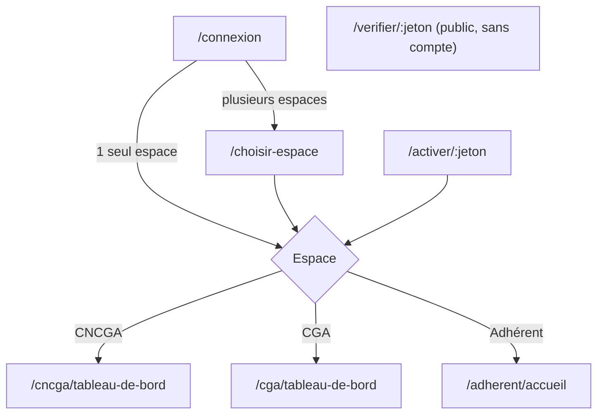
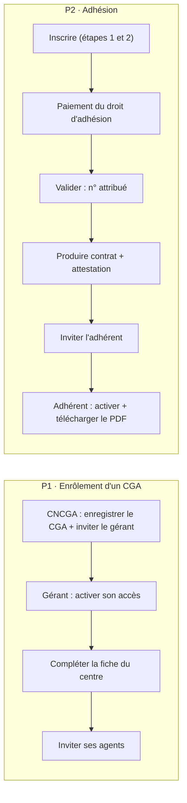

# 03 — App flow · Navigation et parcours · CGA Connect

> Version 1.2 · 15/10/2026 (précisions du Directeur : deux portefeuilles natifs, bascules dans les deux sens, radiation toujours manuelle, interface d'habilitations par rôle, Accessoires dans le portefeuille CGA seulement) · v1.1 (compte rendu du 14/10/2026 : portefeuilles, radiation en deux temps, exclusivité bloquante, habilitations par utilisateur, factures FNE, campagne de clôture, rapport modernisé, Compta Flow) · Références : 01-PRD (`F-`, `RG-`), 04-UX-UI (composants), 05-BACKEND-SCHEMA.
> Pour chaque écran : route, accès, contenu, et **ce qui se passe après chaque action** (→ destination, message affiché).
> Conventions : `→` = navigation ; « toast ✓ » = message de succès éphémère ; « modale » = fenêtre par-dessus l'écran courant ; `:id` = identifiant ULID.

---

## 1. Carte générale

Après connexion :
- utilisateur à **un seul** rattachement actif → tableau de bord de cet espace ;
- **plusieurs** rattachements → `/choisir-espace`, présélectionné sur le dernier espace utilisé.

Le menu de l'en-tête « Changer d'espace » rouvre `/choisir-espace`.

---

## 2. Écrans publics

| Route | Écran | Comportement |
|---|---|---|
| `/connexion` | Connexion | Champs « Téléphone ou e-mail », « Mot de passe », lien « Mot de passe oublié ». **Se connecter** → un espace : tableau de bord ; plusieurs : `/choisir-espace` ; échec : message sous le formulaire « Identifiants incorrects » ; 5 échecs : « Trop de tentatives, réessayez dans 15 minutes » ; compte sans rattachement actif : « Votre accès n'est pas actif. Contactez votre CGA. » |
| `/mot-de-passe-oublie` | Étape 1 : téléphone ou e-mail | **Recevoir un code** → étape 2 (toujours le même message, même si le compte n'existe pas : « Si ce compte existe, un code a été envoyé ») |
| idem | Étape 2 : code à 6 chiffres + nouveau mot de passe ×2 | **Valider** → `/connexion` + toast « Mot de passe modifié » ; code faux : « Code incorrect (n essai(s) restant(s)) » ; 3 échecs ou expiré : retour à l'étape 1 |
| `/activer/:jeton` | Activation d'un compte invité | Affiche « Bienvenue {prénom}, {organisation} vous invite en tant que {rôle} ». Champs : mot de passe ×2 ; case CGU ; pour un adhérent, cases « J'accepte de recevoir des SMS / WhatsApp d'information ». **Activer mon accès** → session ouverte → tableau de bord de l'espace. Jeton invalide ou expiré → écran « Ce lien n'est plus valide » + contact de l'organisation qui invite |
| `/verifier/:jeton` | Vérification d'un document (sans compte) | Bandeau vert « Document authentique et valide » ou rouge « Document ANNULÉ le jj/mm/aaaa » ; type, date, CGA émetteur, nom de l'adhérent, n° d'adhésion. Jeton inconnu : « Aucun document ne correspond à ce code ». Aucune autre action |
| `/choisir-espace` | Sélecteur d'espace | Cartes : organisation, rôle, compteur de notifications non lues. Clic → tableau de bord de l'espace |

---

## 3. Espace CNCGA

### 3.1 Menu
Tableau de bord · Membres (CGA) · Cotisations · Rapports trimestriels · Préoccupations · Formations & séminaires · Communications · Statistiques · Paramètres (référentiels, utilisateurs, paramètres réseau).

Les entrées visibles dépendent du rôle :
- `cncga_dues` : Tableau de bord, Cotisations, Membres (lecture) ;
- `cncga_training` : Tableau de bord, Formations, Communications ;
- `cncga_viewer` : tout en lecture, sans Paramètres.

### 3.2 Écrans

**`/cncga/tableau-de-bord`** (F-DSH-01)
- Sélecteur de période (Mois par défaut) · 4 indicateurs · graphique mensuel des cotisations · alertes · mention de couverture « Sur la base de x CGA abonnés sur 111 ».
- Clic sur une alerte « Rapport en retard » → `/cncga/rapports?filter=late` ; « CGA impayés » → `/cncga/cotisations?filter=unpaid` ; « Agrément à échéance » → fiche du CGA.

**`/cncga/membres`** (F-ORG-01)
- Tableau des CGA, recherche, filtres.
- **+ Enregistrer un CGA** → modale « Nouveau CGA » (F-ORG-02). **Enregistrer** → toast ✓ « CGA enregistré » → `/cncga/membres/:id`. Option « Ouvrir l'accès maintenant » : champs gérant (nom, téléphone) ; à l'enregistrement, l'invitation est envoyée (toast « Invitation envoyée au gérant »).
- **Importer** → modale import (F-IMP-01) : télécharger le modèle, déposer le fichier → barre de progression → rapport (lignes importées, rejetées, téléchargeable).
- Clic sur une ligne → `/cncga/membres/:id`.

**`/cncga/membres/:id`** (F-ORG-04) — onglets Identité · Utilisateurs · Cotisations · Rapports · Chiffres clés · Préoccupations.
- **Modifier** → formulaire en place → **Enregistrer** → toast ✓.
- **Abonnement** → modale (état, dates) → toast ✓.
- **Suspendre** (Présidente) → modale motif obligatoire → **Confirmer la suspension** → badge « Suspendu » + toast. **Réactiver** → modale motif → toast.
- **Déclarer le retrait d'agrément** (Présidente) → modale (date, motif, avertissement « Le CGA sera suspendu et l'état des résiliations de ses adhérents sera préparé ») → **Confirmer** → toast + retour sur la fiche.
- **Inviter un gérant** (si aucun accès) → modale nom + téléphone → toast « Invitation envoyée ».

**`/cncga/cotisations`** (F-COT-02)
- Choix de l'année · tableau (CGA, dû, réglé, reste, statut, dernière relance) · totaux.
- Ligne « En attente de confirmation » → **Examiner** → panneau latéral (montant, preuve consultable) → **Confirmer** (toast « Paiement confirmé, reçu n° … ») ou **Rejeter** (modale motif → toast).
- **Enregistrer un paiement** → modale (CGA, montant, date, mode, référence) → toast ✓ + reçu.
- **Relancer** (ligne non à jour) → modale aperçu du message → **Envoyer** → toast « Relance envoyée » ; colonne « Dernière relance » mise à jour.
- **Facturer** (ligne ou sélection) → facture de cotisation créée et soumise à la certification FNE (même cycle que `/cga/factures`) ; colonne « Facture » avec statut FNE ; le CGA télécharge la facture certifiée depuis `/cga/cotisation`.
- Aucune action « Suspendre » automatique : à J+90, l'alerte propose à la Présidente d'ouvrir la fiche du CGA pour décider.
- **Exporter** → fichier Excel téléchargé.

**`/cncga/rapports`** — tableau CGA × trimestre (Transmis / En retard / **Hors délai réglementaire** / Non transmis / Accusé reçu). Clic sur une cellule transmise → panneau « Tableau de synthèse » (feuille Résumé agrégée, sans nom d'adhérent).

**`/cncga/preoccupations`** (F-PRE-02) — liste des demandes des CGA (filtres statut, catégorie, CGA). Clic → `/cncga/preoccupations/:id`. Onglet « Indicateurs » : volumes et délais des demandes adhérents → CGA, agrégés (F-PRE-04).

**`/cncga/preoccupations/:id`**
- Fil de messages · zone de réponse avec bascule « Note interne » · pièces jointes.
- **Envoyer** → message ajouté + toast ; le demandeur est notifié.
- Changement de statut (menu) : En examen · Traitée · Rejetée (modale motif) → badge mis à jour.

**`/cncga/formations`** (F-FOR-01)
- Liste (à venir, passées).
- **+ Créer une formation** → `/cncga/formations/nouvelle` → **Publier** (→ `/cncga/formations/:id` + toast « Formation publiée, n personnes notifiées ») ou **Enregistrer en brouillon**.

**`/cncga/formations/:id`** — onglets Détails · Inscrits · Liste d'attente · Présence · Évaluations.
- **Valider** / **Refuser** une inscription (si option active).
- **Inscrire des personnes** → modale de recherche (agents CGA).
- **Annuler la formation** → modale motif → inscrits notifiés.
- Après la date : onglet Présence → cocher présent / absent → **Clôturer la session** → attestations générées pour les présents (toast « n attestations générées »).

**`/cncga/communications`** (F-COM-01)
- Liste des annonces.
- **+ Nouvelle annonce** → modale (titre, texte, pièce jointe, cible, case e-mail) → **Publier** → toast « Annonce publiée à n destinataires ».

**`/cncga/statistiques`** (F-STA-01) — période · 4 indicateurs macro (« Non disponible — saisir les références {année} » si absentes, lien vers Paramètres) · graphiques (recettes par CGA, secteurs, régimes) · carte par DR (survol : CA, CGA, adhérents ; clic : liste agrégée par commune) · **Exporter la plaquette PDF** · **Exporter Excel**.

**`/cncga/parametres`** — onglets :
- Utilisateurs CNCGA (Présidente : inviter, rôles, désactiver) ;
- Secteurs (valider / rejeter / fusionner les propositions) ;
- DR, CDI, communes ;
- Catalogue des obligations (consultation par version, import d'une nouvelle version) ;
- Références nationales ;
- Paramètres réseau (cotisation, échéances, délais) ;
- Jours fériés ;
- **Règles du rapport** : règle « cotisation augmentée » (base de comparaison, seuil %, montant avant / après abattement) ;
- **Bancabilité** : poids des 4 critères (compteur « Total : 100 % », enregistrement refusé sinon), seuils A / B, ancienneté, grille de conformité, liste des pièces (ajouter, désactiver, obligatoire, validité en mois). **Recalculer tous les scores** → confirmation → toast « Recalcul lancé ».

Chaque enregistrement → toast ✓.

---

## 4. Espace CGA

### 4.1 Menu
Tableau de bord · Adhérents · Échéances · Clôture annuelle · Rapport trimestriel · Factures · Préoccupations · Formations · Communications · Cotisation CNCGA · Gestion interne · Bancabilité (si activée) · Statistiques (position du CGA) · Paramètres.

Rôles :
- secrétaire : sans Communications, Cotisation, Gestion interne, Paramètres ;
- comptable, juriste et fiscaliste : sans Cotisation, Gestion interne, Paramètres ;
- chargé des cotisations et honoraires : Tableau de bord, Adhérents (lecture), Factures, Échéances ;
- formateur : Tableau de bord, Formations, Adhérents (lecture).

Le menu est calculé à partir des **droits effectifs** de l'utilisateur (profil + ajustements individuels, RG-ROLE-07), jamais à partir du seul rôle.

### 4.2 Bannières bloquantes
- **CGA suspendu** : bandeau rouge permanent « Votre centre est suspendu depuis le … : consultation seule » ; toutes les actions d'écriture sont masquées.
- **Fiche du CGA incomplète** (RG-ORG-04) : bandeau orange « Complétez la fiche du centre pour produire vos documents » → `/cga/parametres/centre`.
- **Agrément en cours** (RG-ORG-03) : bouton « Inscrire un adhérent » désactivé, avec info-bulle explicative.

### 4.3 Écrans

**`/cga/tableau-de-bord`** (F-DSH-02)
- Indicateurs, échéances sous 15 jours, avancement du rapport, alertes.
- Clic sur une alerte :
  - « n adhérents reclassés au réel » → `/cga/adherents?filter[regime]=RSI,RNI&filter[portfolio]=cga` ;
  - « Honoraires impayés » → `/cga/adherents?filter[fees]=overdue` ; « n impayés depuis plus de 3 mois » → même liste filtrée, avec action **Bloquer l'attestation** par ligne (gérant) ;
  - « n radiations en attente de validation » → `/cga/adherents?tab=radiations-en-cours` ;
  - « Factures en attente de certification » → `/cga/factures?filter[status]=pending_certification` ;
  - « Clôture : n dossiers en retard » → `/cga/cloture` ;
  - « Dossiers à compléter » → `/cga/adherents?tab=brouillons` ;
  - « Rapport T3 à 79 % » → `/cga/rapports/:id`.

**`/cga/adherents`** (F-ADH-01)
- Sélecteur de portefeuille en tête : **Portefeuille CGA** · **Portefeuille Cabinet** (selon les droits) · **Tous**. Badge de portefeuille sur chaque ligne.
- Onglets **Actifs** · **Dossiers à compléter** · **Radiations en cours** · **Radiés / clos** ; recherche (raison sociale, NCC, n° CGA Connect, **ancien n°**, n° client, téléphone) ; filtres (régime, CDI, honoraires ; **apporteur / Accessoire n** dans le portefeuille CGA, si droit « Voir les apporteurs ») ; tableau paginé (colonnes « N° » et « Ancien n° »).
- **+ Inscrire un adhérent** → `/cga/adherents/nouveau`.
- **Importer un portefeuille** (gérant) → `/cga/imports/adherents`.
- **Exporter** → Excel.
- Clic sur une ligne → `/cga/adherents/:id`.

**`/cga/adherents/nouveau`** — assistant en 2 étapes (F-ADH-02)
- **Étape 1 « Identification »** : choix du **portefeuille** (CGA par défaut, ou Cabinet) ; régimes proposés selon le portefeuille (CGA : TEE, RME ; Cabinet : TEE, RME, RSI, RNI) ; apporteur d'affaires facultatif, **affiché seulement pour le portefeuille CGA** (et si droit) ; passer au portefeuille Cabinet vide et masque ce champ. À la sortie du champ NCC, l'API est interrogée.
  - Doublon dans le CGA : erreur sous le champ « Ce NCC existe déjà dans votre centre » + lien vers le dossier.
  - Portefeuille CGA et adhérent d'un autre CGA (actif ou radiation en cours) : **blocage** — encadré rouge « Ce contribuable est adhérent d'un autre CGA. L'inscription sera possible dès que sa radiation y aura été validée. » ; boutons **Suivant** et **Valider** désactivés ; proposition **Inscrire dans le portefeuille Cabinet**. Le serveur refait le contrôle à la validation (409 `membership_exclusive`).
  - **Suivant** → étape 2 (validation des champs de l'étape 1, erreurs affichées sous chaque champ).
- **Étape 2 « Activité et adhésion »** : secteur (avec **Proposer un secteur** → modale nom → secteur ajouté « proposé ») ; CA de référence ; portefeuille CGA : **date de signature du contrat CGA** + case obligatoire « Le contrat CGA est signé par les deux parties » + dépôt facultatif de l'exemplaire signé (sinon pièce « en attente ») ; droit d'adhésion (portefeuille CGA) ; honoraires (pré-remplis par le barème) ; bloc « Obligations proposées » (cases cochées par défaut, **+ Ajouter une obligation** → recherche dans le catalogue).
- **Enregistrer comme brouillon** → `/cga/adherents/:id` (statut Brouillon) + toast « Brouillon enregistré ».
- **Valider l'adhésion** :
  - si le droit d'adhésion n'est pas encore payé → modale « Enregistrer le paiement du droit d'adhésion » (montant pré-rempli, date, mode, référence) → **Enregistrer et valider** ;
  - succès → `/cga/adherents/:id` + bandeau vert « Adhésion validée — n° 2026-DCK-0143 » (portefeuille Cabinet : « Dossier client créé — n° CAB-DCK-00087 », sans contrat ni attestation) avec 3 boutons : **Produire le contrat et l'attestation** · **Inviter l'adhérent en ligne** · **Fermer** ;
  - éléments manquants → modale listant les champs à compléter, avec liens vers l'étape concernée.
- **← Retour** (étape 2 → étape 1) conserve la saisie. **Annuler** → modale « Abandonner la saisie ? » → `/cga/adherents`.

**`/cga/adherents/:id`** (F-ADH-03)
- En-tête : raison sociale, n° CGA Connect (et « Ancien n° … » en gris s'il existe), badges (portefeuille CGA / Cabinet, Accessoire n si droit, Radiation en cours, Attestation bloquée) ; boutons **Modifier**, **Documents ▾** (Produire contrat · Produire attestation · Déposer un document), **Accès en ligne**, **⋯** (Changer de régime · Demander la radiation · Valider la radiation · Basculer vers le portefeuille CGA · Bloquer / Débloquer l'attestation · Annuler la radiation · Supprimer le brouillon).
- Bandeaux : reclassement au réel (« Radiation requise — reclassement au régime réel », bouton **Demander la radiation** pré-rempli avec ce motif et l'option « Basculer dans le portefeuille Cabinet ») ; « Pièces en attente (n) » → onglet Pièces ; alerte « Honoraires impayés depuis 4 mois » avec bouton **Bloquer l'attestation** (gérant) ; « Attestation bloquée le … par … : motif » avec **Débloquer** ; « Radiation en cours depuis le … » avec **Valider la radiation**.
- Onglets :

| Onglet | Contenu et actions |
|---|---|
| Identité | Fiche en lecture. **Modifier** → formulaire ; si raison sociale, NCC ou régime modifiés, le champ « Justificatif » devient obligatoire. **Enregistrer** → toast ✓ ; si un champ du contrat ou de l'attestation a changé → modale « Ces informations figurent sur le contrat et l'attestation. Régénérer les documents ? » [Régénérer] [Plus tard] |
| Obligations | 4 blocs (Impôts, CNPS, CMU, Autres). Par ligne : menu **Marquer faite**, **Saisir le montant dû**, **Enregistrer un paiement** (modale montant, date, preuve), **Confirmer la déclaration de l'adhérent** / **Corriger**. Lignes « déclaré par l'adhérent — à confirmer » en surbrillance orange. **Gérer les obligations** → modale liste des obligations attribuées (ajouter / retirer). **+ Autre administration** → modale (administration, montant, échéance) |
| Honoraires et paiements | Échéances (période, montant, payé, statut) · paiements (date, montant, mode, statut, reçu) · factures (n°, statut FNE, PDF certifié). **Émettre une facture** → voir `/cga/factures`. **Enregistrer un paiement** → modale (nature, périodes cochées, montant, date, mode, référence) → toast « Paiement enregistré — reçu REC-DCK-2026-00045 » + reçu téléchargeable. Paiement déclaré par l'adhérent → **Examiner** → Confirmer / Rejeter (motif) |
| Documents | Liste (type, n°, date, statut, PDF, Word). Ligne « en cours de production » avec indicateur de chargement, remplacée automatiquement quand le document est prêt (toast « Contrat prêt »). Menu ligne : **Annuler** (modale motif) · **Rééditer** (attestation, duplicata) |
| Pièces | 5 pièces avec statut ; **Déposer** → sélection du fichier → statut « reçue » |
| Accès en ligne | Accès principal et secondaires (nom, téléphone, état). **Inviter** → modale (nom, téléphone, e-mail, type d'accès) → toast « Invitation envoyée par SMS ». **Renvoyer** · **Désactiver** |
| Préoccupations | Demandes de cet adhérent → `/cga/preoccupations/:id` |
| Clôture | Exercice en cours : 4 étapes (pièces, régularisation, finalisation, dépôt) avec date, statut, auteur ; **Marquer l'étape faite** (modale date, pièce facultative ; dépôt : référence et accusé) |
| Historique | Journal : date, auteur, champ, ancienne → nouvelle valeur, justificatif, **source** (saisie, import, Compta Flow) ; bascules de portefeuille ; blocages d'attestation |
| Bancabilité | Voir §4.4 |

- **Demander la radiation** → modale : **initiateur** (CGA / cabinet · contribuable · SP-CGA) → motifs filtrés selon l'initiateur → précision, date d'effet, observation, pièce (obligatoire selon le motif : justificatif de transfert, lettre de résiliation, PV, décision de retrait), référence de la demande au SP-CGA (initiateur CGA) → **Enregistrer la demande** → statut « Radiation en cours », toast « Demande de radiation enregistrée ».
- **Valider la radiation** (gérant, expert-comptable) → modale : date et référence de validation, issue (**Clore le dossier** · **Basculer dans le portefeuille Cabinet**) + rappel des effets → **Confirmer** → statut « Radié » (ou dossier dans le portefeuille Cabinet), toast « Radiation validée. Courrier de notification au CDI en cours de production. » ; le bouton **Annuler la radiation** reste visible 30 jours (gérant). Contribuable ou décès : les deux étapes peuvent s'enchaîner dans la même modale (« Valider immédiatement »).
- **Basculer vers le portefeuille Cabinet** (dossier CGA) → ouvre la modale « Demander la radiation » pré-réglée (issue « Basculer dans le portefeuille Cabinet », motif à choisir : reclassement au réel, résiliation du contrat par le client…) ; après **Enregistrer la demande**, l'utilisateur habilité **valide** la radiation (même modale enchaînable). Rappel affiché : « La sortie du portefeuille CGA met fin au contrat CGA : le dossier figurera dans l'état des résiliations du trimestre. » Si le dossier est « Accessoire n », avertissement « Le rattachement à l'apporteur prendra fin ».
- Aucune radiation n'est jamais faite par la plateforme : les alertes (reclassement au réel, perte d'agrément du CGA) proposent seulement d'ouvrir cette modale.
- **Basculer vers le portefeuille CGA** (dossier Cabinet TEE / RME) → modale : date de signature du contrat CGA, case « Le contrat CGA est signé par les deux parties », exemplaire signé (fichier, facultatif), apporteur (facultatif), paiement du droit d'adhésion (pré-rempli) → contrôle d'exclusivité → **Basculer** → n° d'adhésion attribué, toast « Dossier intégré au portefeuille CGA — n° 2026-DCK-0151 ». Refus d'exclusivité → message de blocage (sans nom du CGA).
- **Bloquer l'attestation** → modale motif (obligatoire) → badge « Attestation bloquée » ; **Débloquer** → modale motif → badge retiré.
- **Annuler la radiation** → modale motif → dossier restauré + toast. Si le rapport du trimestre est déjà transmis : avertissement « Le rapport T{n} déjà transmis devra être corrigé ».
- **Changer de régime** → modale (nouveau régime, date d'effet, motif, justificatif). Portefeuille CGA, choix RSI ou RNI → avertissement « Reclassement au réel : une demande de radiation est attendue (alerte à 90 jours). Le dossier pourra être basculé dans le portefeuille Cabinet ».
- **Supprimer le brouillon** → modale confirmation → `/cga/adherents?tab=brouillons`.
- **Réimporter depuis un autre CGA** (dans « Inscrire un adhérent », lien « L'entreprise vient d'un autre CGA ? ») → modale NCC + accord écrit (fichier) → identité pré-remplie dans l'assistant.

**`/cga/echeances`** (F-OBL-06)
- Planning groupé (date · obligation · nombre d'adhérents · faits / à faire · plateforme), filtres.
- Clic → panneau latéral listant les adhérents concernés (lien vers chaque dossier, onglet Obligations).
- **Envoyer un rappel** → `/cga/communications/nouveau` pré-rempli (destinataires = adhérents non faits, modèle « Rappel d'échéance »).
- Onglet **Mobilisation des recettes** : totaux par nature d'impôt, par contribuable, taux de recouvrement.

**`/cga/cloture`** (F-OBL-08) — campagne de clôture de l'exercice (sélecteur d'année).
- Frise des 4 étapes avec leurs dates (30/01, 28/02, 31/03, 30/05 par défaut) et le nombre de dossiers par étape ; filtres portefeuille, agent, étape, en retard.
- Tableau par dossier : étapes cochées, retard en orange ; sélection multiple → **Marquer l'étape faite** · **Envoyer un rappel de pièces** (→ envoi groupé pré-rempli) · **Affecter à un agent**.
- Bloc « Pour le rapport » : SMT et bilans établis / transmis (portefeuille CGA) repris automatiquement dans la section 4 du rapport.

**`/cga/factures`** (F-PAY-05, F-PAY-06) — liste (n°, client, montant, date, **statut FNE** : Brouillon · En attente de certification · Certifiée · Rejetée) ; filtres.
- **+ Émettre une facture** → modale : client (adhérent), sommes dues à facturer (cases : droit d'adhésion, échéances d'honoraires, formation) ; montants calculés par le serveur → **Créer et soumettre à la certification**.
  - mode API : statut « En attente de certification » puis « Certifiée » (notification) ; rejet → motif de la DGI affiché, **Corriger et resoumettre** ;
  - mode manuel : statut « En attente de certification » + bouton **Saisir la certification** → modale (numéro FNE, PDF certifié) → « Certifiée ».
- Facture certifiée : **Télécharger PDF**, **Envoyer à l'adhérent** ; plus aucune modification, seulement **Émettre un avoir**.
- Une facture non certifiée n'est ni téléchargeable par l'adhérent ni envoyable.

**`/cga/rapports`** — liste des rapports (année, trimestre, statut, date limite, version). **+ Préparer le rapport T{n}** (trimestre courant ou précédent non créé) → `/cga/rapports/:id`.

**`/cga/rapports/:id`** (F-RPT-02 à 07)
- Barre d'avancement par section (1 à 6) ; chaque section s'ouvre en accordéon.
- Section 1 à 3 : rappel « Vérifiez la fiche permanente du centre » + lien **Mettre à jour** → `/cga/gestion-interne/fiche` (retour automatique ensuite) ; section 2 : tableau des impôts du trimestre par dirigeant (saisie en ligne).
- Section 4 et 6 : champs texte et nombres, enregistrement automatique (indicateur « Enregistré ») ; nombres de SMT et bilans pré-remplis depuis la campagne de clôture (modifiables) ; section 6 complétée par l'**analyse qualitative** (synthèse pré-rédigée modifiable, faits marquants, perspectives).
- Section 5 : états calculés en lecture (portefeuille CGA uniquement), par état, avec graphiques et anomalies signalées (ex. « 3 adhérents sans n° de section et parcelle » → liens vers les dossiers). Indicateur de source : « CA et paiements : Compta Flow (synchronisé le …) » ou « saisie / import » ; écarts corrigés par Compta Flow listés.
- Bandeau d'échéance : « Date limite : 31/10 · échéance réglementaire : 15/11 » ; orange après la date limite, rouge après l'échéance réglementaire.
- **Prévisualiser** → aperçu du rapport modernisé (pages, graphiques).
- **Générer le rapport** (actif quand tout est à 100 %) → statut « Génération en cours » → toast « Rapport généré (V1) » → téléchargements PDF / Word du rapport modernisé, et **Excel (classeur de compatibilité)** si le paramètre réseau est actif.
- **Enregistrer la transmission** (gérant, expert-comptable) → modale (date, mode, référence) → statut « Transmis » + bordereau produit + toast « Transmission enregistrée. Le CNCGA voit l'état de transmission et le tableau de synthèse. »
- **Enregistrer l'accusé de réception** → modale (date, référence, fichier) → statut « Accusé reçu ».
- **Corriger** (après transmission) → modale motif → nouvelle version V2 en brouillon (la V1 reste consultable dans l'onglet « Versions »).

**`/cga/preoccupations`** — onglets **Reçues** (des adhérents) · **Envoyées au CNCGA**. Filtres statut, catégorie ; badge « sans réponse depuis 15 j ».
- **+ Écrire au CNCGA** → modale (catégorie, objet, message, pièces jointes) → toast ✓.

**`/cga/preoccupations/:id`** — comme côté CNCGA, avec en plus **Transmettre au CNCGA** (gérant, expert-comptable) → modale message d'accompagnement → statut d'origine « En examen — transmise au CNCGA » + nouvelle demande dans « Envoyées ».

**`/cga/formations`** — onglets **Mes formations** (organisées par le CGA) · **Formations du réseau** (CNCGA).
- **+ Créer** → formulaire (publics limités à ses agents et adhérents).
- Sur une formation du réseau : **Inscrire des agents ou des adhérents** → modale de sélection multiple → toast « n inscriptions (dont m en liste d'attente) ».
- Détail d'une formation organisée : comme côté CNCGA.

**`/cga/communications`** — onglets **Annonces** · **Envois groupés** · **Historique des envois**.
- **+ Nouvel envoi** → `/cga/communications/nouveau` :
  1. destinataires (filtres régime, secteur, échéance, honoraires impayés ; compteur en direct) ;
  2. canaux (cases ; quota SMS restant affiché) ;
  3. message (libre ou modèle) + aperçu ;
  4. **Envoyer** :
     - ≤ 50 destinataires → toast « Envoi en cours à n destinataires » → historique ;
     - > 50 et utilisateur non gérant → « Envoyer pour validation » → statut « En attente de validation » ; le gérant est notifié et valide depuis l'historique (**Valider** / **Refuser**) ;
     - quota insuffisant → erreur « Quota SMS insuffisant (reste x) ».
- **+ Nouvelle annonce** → modale → publiée dans « Message de mon CGA ».

**`/cga/cotisation`** (F-COT-06) — cotisation de l'année (dû, réglé, reste, échéance), paiements, reçus. **Déclarer un paiement** → modale (montant, date, mode, référence, preuve obligatoire) → statut « En attente de confirmation » + toast.

**`/cga/gestion-interne`** — onglets **Fiche permanente** (dirigeants, personnel, moyens matériels, présentation : listes éditables, **+ Ajouter**) · **Obligations du centre** (liste, **+ Ajouter**, statut modifiable).

**`/cga/statistiques`** (F-STA-02) — indicateurs du CGA comparés aux moyennes du réseau (ou « Données insuffisantes »).

**`/cga/parametres`** (gérant) — onglets :
- **Centre** (fiche complète F-ORG-03, avec téléversement du logo, de la signature et du cachet + aperçu d'un document type) ;
- **Utilisateurs** (inviter, profils — un ou plusieurs —, désactiver) ; clic sur un utilisateur → **Habilitations** : « nuage » des droits regroupés par module, cases à cocher pré-cochées selon le profil ; chaque case modifiée porte le libellé « ajusté pour cet utilisateur » et un lien **Revenir au profil** ; droits verrouillés grisés 🔒 ; **Enregistrer** → toast « Habilitations de {nom} mises à jour » ;
- **Droits par rôle** (`/cga/parametres/droits`) : une carte par rôle du centre (hors gérant) — libellé, nombre d'utilisateurs, nombre de droits, badge « personnalisé » ; clic → **interface dédiée du rôle** `/cga/parametres/droits/:role` : droits groupés par module (sections repliables), case à cocher et description par droit, cases différentes du réseau marquées « personnalisé », droits verrouillés grisés 🔒, « Tout accorder / Tout retirer » par module, liste des utilisateurs ayant ce rôle (lien vers leurs ajustements individuels) ; **Enregistrer** → modale d'impact (« n utilisateurs ; +x droits, −y droits ») → toast ✓ ; **Revenir aux droits du réseau** pour ce rôle ;
- **Barème** (droit d'adhésion, honoraires par régime) ;
- **Règles** (seuil d'alerte des honoraires impayés, jour d'échéance des honoraires, dates internes de la campagne de clôture) ;
- **Apporteurs d'affaires** (portefeuille CGA) : liste « Accessoire n » (nom, contact, conditions, nombre de dossiers, actif ; **+ Ajouter**) ;
- **Facturation FNE** (F-ADM-07) : mode (Manuel · API DGI · Sell Flow), identifiants (masqués « •••• 4F2A »), **Tester la connexion** ;
- **Compta Flow** (F-INT-03) : URL, identifiants, interrupteur Actif, **Tester la connexion**, **Synchroniser maintenant**, historique des synchronisations (lus, rapprochés, non rapprochés avec liste des NCC, écarts) ;
- **Obligations locales** ;
- **Campagne d'attestations** : **Lancer la campagne {année}** → modale « n adhérents éligibles, m bloqués (motifs) » → **Lancer** → toast « Production de n attestations en cours » ; une notification à la fin.

**`/cga/imports/adherents`** (F-IMP-02)
- Étapes : télécharger le modèle (colonnes portefeuille, ancien n°, apporteur) → déposer le fichier → numéro de départ de la séquence CGA Connect (proposé) → **Analyser** → aperçu (n importables, n brouillons, n rejetés avec motifs ; pour chaque ligne : ancien n° → n° CGA Connect attribué) → **Importer** → progression → rapport téléchargeable → lien « Voir les adhérents importés ».

### 4.4 Bancabilité (si activée)
- **`/cga/bancabilite`** : portefeuille (adhérent, score, note, pièces, demandes en cours) · onglet **Banques partenaires** (réseau en lecture, locales éditables).
- Dossier adhérent, onglet **Bancabilité** :
  - sans consentement : écran vide « Consentement de l'adhérent requis » + **Enregistrer le consentement** (modale : accord recueilli en ligne par l'adhérent, ou accord écrit à déposer) ;
  - avec consentement : score et note · checklist des 13 pièces (déposer, date d'expiration) · niveau de conformité (sélecteur) · **Recalculer le score** · demandes de financement (**+ Nouvelle demande** → modale banque, objet, montant → ligne « En préparation » ; changement de statut avec motif) · **Produire le dossier PDF** → document prêt (toast).

---

## 5. Espace adhérent (mobile d'abord)

### 5.1 Navigation
Barre basse sur mobile : **Accueil · Obligations · Documents · Messages · Plus** (Plus = Formations, Ma bancabilité si activée, Mon profil, Changer d'espace, Déconnexion). Menu latéral sur ordinateur.

### 5.2 Écrans

**`/adherent/accueil`** (F-DSH-03) — prochaine échéance (carte cliquable → Obligations), honoraires, impôts dus, CNPS + CMU dus, échéances du mois, « Message de mon CGA », documents récents.
- Adhérent radié : bandeau « Votre adhésion a pris fin le … Vos documents restent consultables jusqu'au … » ; seuls Documents et Profil sont accessibles.

**`/adherent/obligations`** (F-OBL-05) — 4 blocs repliables, chacun avec récapitulatif « Total dû ».
- Sur une ligne à faire ou à payer : **Signaler comme fait / payé** → modale (montant payé, date, preuve facultative) → ligne « Déclaré — en attente de confirmation par votre CGA » + toast.
- Le CGA confirme → la ligne passe « Payé » (notification) ; s'il corrige → notification avec la valeur retenue.

**`/adherent/cloture`** (si une campagne est ouverte) — étapes de l'exercice et pièces attendues, avec dates ; **Déposer des pièces** → crée une préoccupation « Pièces de clôture » avec fichiers joints.

**`/adherent/honoraires`** (accès depuis la carte Honoraires de l'accueil) — échéances et paiements, reçus PDF. **Déclarer un paiement** → modale (montant, date, mode, référence, preuve obligatoire) → « En attente de confirmation ».

**`/adherent/documents`** — liste (contrat, attestations, reçus, **factures certifiées FNE**, documents déposés par le CGA), **Télécharger PDF**. Client du portefeuille Cabinet : pas de contrat ni d'attestation CGA. Document annulé : badge rouge « Annulé ».
- **Demander un document** → modale (type : attestation, état financier, autre ; message) → crée une préoccupation « Demande de document » → `/adherent/messages/:id`.

**`/adherent/messages`** — liste de ses préoccupations. **+ Nouvelle demande** → formulaire (catégorie, objet, message, pièce jointe) → `/adherent/messages/:id` + toast « Votre demande a été envoyée à {CGA} ».

**`/adherent/messages/:id`** — fil, réponse ; si statut Traitée ou Rejetée : bouton **Rouvrir la demande** → statut « Ouverte ».

**`/adherent/formations`** — formations ouvertes à l'adhérent (CGA et réseau) + « Mes inscriptions ».
- **S'inscrire** → modale récapitulative (date, lieu, prix) → résultat :
  - « Inscription confirmée » ;
  - « Vous êtes en liste d'attente (position n) » ;
  - « Inscription en attente de validation ».
- **Se désinscrire** (jusqu'à J-2) → confirmation. Après la session : **Évaluer** (note + commentaire) et **Télécharger l'attestation** si présent.

**`/adherent/bancabilite`** (si activée) — score, pièces manquantes, demandes. Sans consentement : texte explicatif + **Donner mon accord** (accès principal uniquement) → modale de consentement → toast.

**`/profil`** (tous espaces) — nom, téléphone (changement par code SMS), e-mail, mot de passe, préférences SMS / WhatsApp (adhérents).

---

## 6. Espace plateforme (`platform_admin`)

`/plateforme` — onglets :

| Onglet | Contenu et actions |
|---|---|
| Organisations | Créer le CNCGA, créer et importer des CGA, activer la bancabilité |
| **Utilisateurs CNCGA** | Habilitations par utilisateur du CNCGA (même « nuage » que côté CGA) |
| **Paramètres réseau** | Décalages des relances du rapport (J-15, J-5, J+5), échéance réglementaire (J+15), export du classeur de compatibilité (oui / non), calendrier de clôture par défaut, facturation FNE du CNCGA (cotisations) |
| **Droits du réseau** | Liste des rôles par espace (CNCGA, CGA, adhérent) → **interface dédiée de chaque rôle** `/plateforme/droits/:role` (même présentation que côté CGA : modules, cases, verrous 🔒). Sous-onglet « Ajustements des CGA » (lecture : quels CGA ont personnalisé quels droits de quel rôle). **Enregistrer** → modale « Ce changement concerne n utilisateurs » → toast ✓. **Revenir aux valeurs par défaut** → confirmation → toast |
| **Envois** | Un bloc par canal (SMS, WhatsApp, e-mail) : fournisseur, champs d'identifiants (secrets masqués, « •••• 4F2A »), interrupteur Actif. **Enregistrer** → toast ✓. **Envoyer un test** → modale (numéro ou adresse) → résultat affiché dans la modale : « Message accepté par le fournisseur » ou erreur brute du fournisseur |
| **Données de référence** | Pour chaque jeu (CGA, DR / CDI / communes, obligations, codes d'activité, références nationales) : nombre d'éléments, badge « provisoire » / « validé », **Importer** (modèle Excel, mode « mettre à jour » ou « remplacer », aperçu des changements avant confirmation), **Marquer comme validé** |
| Modèles de documents | Déposer une version (DOCX ou XLSX) → contrôle des variables (liste des variables manquantes ou inconnues) → **Prévisualiser** avec des données de test → **Activer** |
| Journaux | Recherche dans le journal d'audit |
| Accès support | Choisir un CGA + motif → session journalisée, bandeau rouge « Accès support à {CGA} — journalisé » pendant toute la session |
| Technique | Files d'attente, paramètres techniques |

---

## 7. Comportements communs

| Situation | Comportement |
|---|---|
| Session expirée | Toute requête 401 → `/connexion?retour=<page>` + message « Votre session a expiré » ; après connexion, retour à la page |
| Accès interdit (403) | Écran « Vous n'avez pas accès à cette page » + bouton « Retour au tableau de bord » |
| Objet introuvable (404) | Écran « Élément introuvable » |
| Erreur de validation (422) | Erreurs sous chaque champ ; focus sur le premier champ en erreur ; la saisie est conservée |
| Conflit métier (409) | Modale ou bandeau avec le message de l'API et, si fourni, l'action proposée |
| Erreur serveur ou réseau | Toast rouge « Une erreur est survenue. Réessayez. » ; les formulaires gardent la saisie |
| Opération longue (document, import, export, génération de rapport) | Bouton désactivé avec indicateur → toast à la fin ; une notification dans la cloche si l'utilisateur a quitté la page |
| Formulaire modifié non enregistré | Quitter la page → modale « Quitter sans enregistrer ? » |
| Liste vide | Illustration + phrase + action principale (ex. « Aucun adhérent pour l'instant » + **Inscrire un adhérent**) |
| Chargement | Squelettes à la forme du contenu, jamais d'écran blanc |
| Cloche de notifications (en-tête) | Liste des notifications de l'espace actif ; clic → page de l'objet ; **Tout marquer comme lu** |
| Actions irréversibles (radiation, annulation de document, suspension, envoi groupé) | Modale de confirmation reprenant les effets ; bouton de confirmation coloré « danger » |

---

## 8. Parcours critiques (tests de bout en bout)

| # | Parcours | Résultat attendu |
|---|---|---|
| P1 | Enrôlement d'un CGA (ci-dessus) | Le gérant voit son tableau de bord ; les documents sont bloqués tant que la fiche est incomplète |
| P2 | Adhésion complète (ci-dessus) | Numéro continu, PDF avec QR vérifiable sur `/verifier/:jeton` |
| P3 | Adhérent signale un paiement CNPS → CGA confirme | Statut « Payé », recettes fiscales mises à jour dans les agrégats |
| P4 | Honoraires impayés 4 mois | Statut « Impayé (4 mois) », rappel envoyé, alerte au gérant ; l'attestation reste délivrable tant que le gérant ne l'a pas bloquée manuellement ; après blocage, refus avec motif |
| P5 | Demande de radiation (CGA, changement de zone, justificatif) → validation → annulation à J+10 ; dans un autre CGA, inscription du même NCC bloquée avant validation et possible après | Dossier restauré à l'identique, ligne retirée de l'état des résiliations ; message d'exclusivité sans nom du CGA |
| P6 | Rapport trimestriel : préparer → générer → transmettre → accusé → corriger (V2) | Rapport modernisé avec graphiques ; classeur de compatibilité aux agrégats identiques ; aucun dossier Cabinet ; CNCGA voit l'état et le résumé uniquement |
| P7 | Cotisation : CGA déclare 375 000 F → CNCGA confirme | Statut « Partielle », reçu produit, relance J+30 envoyée après la date butoir |
| P8 | Préoccupation adhérent → CGA → transfert au CNCGA → réponse | Fil copié, statuts cohérents des deux côtés |
| P9 | Formation 30 places, 31e inscription, désistement | 31e en liste d'attente puis promue automatiquement et notifiée |
| P10 | Cloisonnement | Un agent du CGA A ne peut ouvrir aucun objet du CGA B ; le CNCGA ne voit aucun nom d'adhérent |
| P11 | Facture d'honoraires en mode manuel : émettre → saisir la certification → l'adhérent télécharge | Facture non téléchargeable avant certification ; PDF avec numéro et QR FNE ; facture certifiée non modifiable |
| P12 | Dossier Cabinet TEE → bascule vers le portefeuille CGA (contrat signé, droit payé) | N° CGA attribué, n° client conservé, dossier compté dans « Nouveaux adhérents » du trimestre |
