# 05 — Backend schema · Modèle de données PostgreSQL · CGA Connect

> Version 1.2 · 15/10/2026 (précisions du Directeur : portefeuilles natifs, contrat ↔ portefeuille CGA, apporteurs limités au portefeuille CGA) · v1.1 (compte rendu du 14/10/2026 : portefeuilles, apporteurs, radiation en deux temps, double numérotation, habilitations par utilisateur, blocage manuel d'attestation, factures FNE, Compta Flow, campagne de clôture, nouveaux critères bancaires) · Base : PostgreSQL 16 · Migrations Laravel 13.
> Références : 01-PRD (`F-xxx`, `RG-xxx`), 02-TRD (conventions §4.3, §7).

---

## 0. Conventions

| Sujet | Règle |
|---|---|
| Clé primaire | `id char(26)` **ULID** pour les tables métier exposées ; `id bigserial` pour les tables techniques (journaux, logs, séquences) |
| Clés étrangères | `<table_singulier>_id`, même type que la PK cible ; **index systématique** |
| Organisation | `organization_id char(26) NOT NULL` sur toute donnée appartenant à un CGA ou au CNCGA (cloisonnement, 02-TRD §6.3) |
| Horodatage | `created_at`, `updated_at timestamptz` partout ; `deleted_at` seulement là où c'est indiqué |
| Auteur | `created_by`, `updated_by char(26) NULL → users.id` sur les tables métier |
| Montants | `bigint` (FCFA), `CHECK (>= 0)` |
| Statuts, motifs, rôles | `varchar(40)` + `CHECK (col IN (...))` ; valeurs = enums PHP |
| Textes | `varchar(n)` pour les codes, `text` pour les contenus libres |
| Fichiers | Jamais de binaire en base : table `files` (S3) |
| Extensions | `pg_trgm`, `unaccent`, `citext` |

Légende des colonnes ci-dessous : **PK** clé primaire · **FK** clé étrangère · **U** unique · **NN** non nul · **N** nullable.

---

## 1. Vue d'ensemble

```mermaid
erDiagram
  users ||--o{ memberships : "a"
  organizations ||--o{ memberships : "rattache"
  members ||--o{ memberships : "accès adhérent"
  organizations ||--o{ members : "CGA possède"
  members ||--o{ member_regime_history : ""
  members ||--o{ member_revenues : ""
  members ||--o{ member_pieces : ""
  members ||--o| radiations : ""
  members ||--o{ member_charges : "droit + honoraires"
  member_charges ||--o{ member_payment_allocations : ""
  member_payments ||--o{ member_payment_allocations : ""
  members ||--o{ member_obligations : "abonnement"
  obligation_types ||--o{ member_obligations : ""
  member_obligations ||--o{ obligation_instances : "échéances"
  obligation_instances ||--o{ obligation_payments : ""
  organizations ||--o{ generated_documents : ""
  members ||--o{ generated_documents : ""
  document_templates ||--o{ generated_documents : ""
  organizations ||--o{ quarterly_reports : ""
  quarterly_reports ||--o{ quarterly_report_versions : ""
  organizations ||--o{ network_dues : "cotisation CNCGA"
  network_dues ||--o{ network_due_payments : ""
  organizations ||--o{ concerns : ""
  concerns ||--o{ concern_messages : ""
  organizations ||--o{ trainings : "organise"
  trainings ||--o{ training_registrations : ""
  organizations ||--o{ announcements : ""
  organizations ||--o{ message_campaigns : ""
  members ||--o| banking_profiles : ""
  business_referrers ||--o{ members : "apporte"
  members ||--o{ portfolio_movements : "bascules"
  members ||--o{ attestation_blocks : ""
  memberships ||--o{ user_permission_overrides : ""
  organizations ||--o{ invoices : "émet"
  invoices ||--o{ fne_certifications : ""
  organizations ||--o| invoicing_providers : ""
  organizations ||--o| flow_connections : ""
  flow_connections ||--o{ sync_runs : ""
  organizations ||--o{ closing_campaigns : ""
  closing_campaigns ||--o{ closing_campaign_items : "par dossier"
```



Domaines : §2 Identité et accès · §3 Organisations · §4 Référentiels · §5 Adhérents et portefeuilles · §6 Honoraires, paiements et factures FNE · §7 Obligations et campagne de clôture · §8 Documents · §9 Rapport trimestriel · §10 Cotisations CNCGA · §11 Statistiques · §12 Préoccupations · §13 Formations · §14 Communication et notifications · §15 Bancabilité · §16 Technique (fichiers, audit, paramètres, séquences, imports).

---

## 2. Identité et accès

### `users` — personnes physiques (un compte par personne, RG-ACC-01)
| Colonne | Type | Contraintes |
|---|---|---|
| id | char(26) | PK |
| first_name | varchar(100) | NN |
| last_name | varchar(100) | NN |
| phone | varchar(20) | NN, U — format E.164 (+225XXXXXXXXXX) |
| phone_verified_at | timestamptz | N |
| email | citext | N, U (partiel `WHERE email IS NOT NULL`) |
| email_verified_at | timestamptz | N |
| password | varchar(255) | N (nul tant que l'invitation n'est pas acceptée) — Argon2id |
| status | varchar(20) | NN, CHECK `invited, active, disabled, deleted` |
| last_login_at | timestamptz | N |
| last_space_membership_id | char(26) | N, FK → memberships.id ON DELETE SET NULL |
| disabled_at | timestamptz | N |
| inactivity_notice_sent_at | timestamptz | N (RG-ACC-06) |
| created_at, updated_at | timestamptz | |

### `memberships` — rattachement d'un utilisateur à un espace (RG-ACC-02)
| Colonne | Type | Contraintes |
|---|---|---|
| id | char(26) | PK |
| user_id | char(26) | NN, FK → users ON DELETE CASCADE |
| organization_id | char(26) | NN, FK → organizations (CNCGA, CGA, ou organisation « plateforme ») |
| member_id | char(26) | N, FK → members ON DELETE CASCADE — renseigné pour les rôles adhérent |
| role | varchar(40) | NN, CHECK `platform_admin, cncga_president, cncga_manager, cncga_dues, cncga_training, cncga_viewer, cga_manager, cga_accountant_expert, cga_accountant, cga_legal, cga_tax_advisor, cga_billing_officer, cga_trainer, cga_secretary, member_owner, member_user` |
| status | varchar(20) | NN, CHECK `invited, active, read_only, disabled` (`read_only` = adhérent radié, RG-ADH-12) |
| read_only_until | date | N |
| invited_by | char(26) | N, FK → users |
| activated_at, disabled_at | timestamptz | N |
| created_at, updated_at | | |

- U (`user_id`, `organization_id`, `role`, `member_id`) — avec `COALESCE(member_id,'')` en index unique.
- CHECK : `role LIKE 'member_%'` ⇔ `member_id IS NOT NULL`.
- Index (`organization_id`, `role`), (`member_id`).
- Un utilisateur peut avoir plusieurs lignes de rôle dans une même organisation (ex. `cncga_dues` + `cncga_training`) : les permissions sont l'union.

### `invitations` (F-AUTH-02)
| Colonne | Type | Contraintes |
|---|---|---|
| id | char(26) | PK |
| membership_id | char(26) | NN, FK → memberships ON DELETE CASCADE |
| token_hash | char(64) | NN, U — SHA-256 du jeton |
| channel | varchar(20) | NN, CHECK `sms, email, sms_email` |
| sent_at | timestamptz | NN |
| expires_at | timestamptz | NN (sent_at + 7 j) |
| accepted_at | timestamptz | N |
| revoked_at | timestamptz | N |

### `otp_codes` — codes SMS (mot de passe oublié, changement de téléphone)
| Colonne | Type | Contraintes |
|---|---|---|
| id | bigserial | PK |
| user_id | char(26) | NN, FK |
| purpose | varchar(30) | NN, CHECK `password_reset, phone_change` |
| target | varchar(120) | NN (téléphone ou e-mail visé) |
| code_hash | char(64) | NN |
| attempts | smallint | NN défaut 0, CHECK ≤ 3 |
| expires_at | timestamptz | NN (+10 min) |
| consumed_at | timestamptz | N |

### `role_permissions` — droits paramétrables (RG-ROLE-01 à 06)
| Colonne | Type | Contraintes |
|---|---|---|
| id | bigserial | PK |
| organization_id | char(26) | N, FK → organizations — nul = paramétrage réseau ; renseigné = surcharge d'un CGA |
| role | varchar(40) | NN (mêmes valeurs que `memberships.role`, hors `platform_admin`) |
| permission | varchar(80) | NN — code du catalogue `config/permissions.php` (ex. `members.radiate`, `reports.transmit`) |
| granted | boolean | NN |
| updated_by | char(26) | N, FK users |
| updated_at | timestamptz | NN |

- U (`COALESCE(organization_id,'')`, `role`, `permission`).
- Contrôles applicatifs :
  - une permission `locked` ne peut pas être écrite ;
  - un CGA ne peut surcharger que les rôles `cga_*` hors `cga_manager`.
- Le catalogue des permissions (code, libellé, module, espace, `locked`, valeur par défaut par rôle) reste dans le code ; l'API `GET /api/v1/permissions/catalog` l'expose pour l'écran de paramétrage.

### `user_permission_overrides` — habilitations par utilisateur (RG-ROLE-07)
| Colonne | Type | Contraintes |
|---|---|---|
| id | bigserial | PK |
| organization_id | char(26) | NN, FK → organizations (= organisation du rattachement, cloisonnement) |
| membership_id | char(26) | NN, FK → memberships ON DELETE CASCADE |
| permission | varchar(80) | NN — code du catalogue |
| granted | boolean | NN (vrai = accordé en plus du profil, faux = retiré) |
| reason | varchar(255) | N |
| updated_by | char(26) | NN, FK users |
| updated_at | timestamptz | NN |

- U (`membership_id`, `permission`).
- Contrôles applicatifs : permission non `locked` ; l'auteur ne peut pas modifier ses propres lignes ; un gérant ne peut viser que des rattachements `cga_*` de son organisation (hors `cga_manager`) ; `platform_admin` pour les rattachements CNCGA.
- Ordre de résolution : verrou → `user_permission_overrides` → `role_permissions` du CGA → `role_permissions` réseau (02-TRD §6.2).

### `sessions` — sessions Laravel (utilisée avec `SESSION_DRIVER=database`, défaut au démarrage).

### Flux d'authentification

```mermaid
sequenceDiagram
  participant G as Gérant CGA
  participant API as API Laravel
  participant DB as PostgreSQL
  participant S as SMS / e-mail
  participant U as Invité (navigateur)
  G->>API: POST /cga/users (nom, téléphone, rôle)
  API->>DB: users (status=invited) + memberships (status=invited) + invitations (token_hash)
  API->>S: lien /activer/{jeton}
  U->>API: GET /auth/invitations/{jeton}
  API->>DB: SHA-256(jeton) = token_hash, non expirée, non acceptée ?
  API-->>U: nom, organisation, rôle
  U->>API: POST /auth/invitations/{jeton}/accept (mot de passe, consentements)
  API->>DB: users.password, status=active ; memberships.status=active ; invitations.accepted_at
  API-->>U: session ouverte, espace actif = ce rattachement
  Note over U,API: Connexions suivantes
  U->>API: GET /sanctum/csrf-cookie puis POST /auth/login (téléphone|e-mail, mot de passe)
  API->>DB: user actif + au moins un membership actif ou read_only ?
  API-->>U: 200 + rattachements
  U->>API: POST /me/space {membership_id}
  API-->>U: espace actif en session ; toutes les requêtes sont filtrées par cette organisation
```

---

## 3. Organisations

### `organizations` — CNCGA, CGA et organisation technique « plateforme »
| Colonne | Type | Contraintes |
|---|---|---|
| id | char(26) | PK |
| type | varchar(20) | NN, CHECK `platform, cncga, cga` ; un seul `cncga` (index unique partiel) |
| name | varchar(200) | NN |
| sigle | varchar(50) | N |
| numbering_abbreviation | varchar(6) | N, U, CHECK `~ '^[A-Z]{2,6}$'` (RG-ORG-05 : figée après le 1er numéro, contrôle applicatif + `abbreviation_locked_at`) |
| abbreviation_locked_at | timestamptz | N |
| legal_form | varchar(40) | N |
| share_capital | bigint | N |
| ncc | varchar(20) | N |
| rccm | varchar(50) | N |
| agreement_number | varchar(60) | N, U partiel |
| agreement_date | date | N |
| agreement_expires_at | date | N (alertes RG-ORG-10) |
| agreement_status | varchar(20) | NN défaut `pending`, CHECK `pending, granted, withdrawn` |
| agreement_withdrawn_at | date | N |
| regional_directorate_id | char(26) | N, FK → regional_directorates |
| tax_office_id | char(26) | N, FK → tax_offices |
| said | varchar(100) | N (service d'assiette) |
| address | text | N |
| city | varchar(100) | NN |
| commune_id | char(26) | N, FK → communes |
| phone_1, phone_2 | varchar(20) | phone_1 NN |
| email | citext | N |
| manager_name | varchar(150) | N |
| expert_name | varchar(150) | N |
| signatory_name | varchar(150) | N |
| signatory_title | varchar(100) | N |
| logo_file_id, signature_file_id, stamp_file_id | char(26) | N, FK → files |
| history_text | text | N (fiche technique du rapport) |
| previous_year_revenue | bigint | N |
| status | varchar(20) | NN défaut `active`, CHECK `active, suspended, terminated` |
| suspended_at | timestamptz | N |
| suspension_reason | text | N |
| subscription_status | varchar(20) | NN défaut `none`, CHECK `none, trial, active, terminated` |
| subscription_started_at, trial_ends_at, subscription_ended_at | date | N |
| data_deletion_due_at | date | N (fin d'abonnement + 6 mois, RG-ORG-07) |
| banking_enabled | boolean | NN défaut false (RG-BNK-00) |
| profile_completed_at | timestamptz | N (RG-ORG-04, calculé par l'Action de mise à jour) |
| created_at, updated_at, deleted_at | | |

Index : (`type`, `status`), (`regional_directorate_id`), (`subscription_status`).

### `organization_status_events` — historique des suspensions, réactivations, retraits d'agrément
| id bigserial PK · organization_id FK NN · event varchar(30) CHECK `suspended, reactivated, agreement_withdrawn, subscription_changed, terminated` · reason text NN · actor_id FK users · occurred_at timestamptz NN |

### `fee_schedules` — barème du CGA (F-PAY-01)
| Colonne | Type | Contraintes |
|---|---|---|
| id | char(26) | PK |
| organization_id | char(26) | NN, FK |
| kind | varchar(20) | NN, CHECK `entry_fee, fees` |
| regime | varchar(5) | N, CHECK `RME, TEE` (nul pour `entry_fee`) |
| amount | bigint | NN |
| periodicity | varchar(15) | N, CHECK `monthly, quarterly, yearly` |
| valid_from | date | NN |

U (`organization_id`, `kind`, `regime`, `valid_from`).

---

## 4. Référentiels (gérés par le CNCGA, lisibles par tous)

> **Données provisoires (RG-DATA-01 à 05)** : les tables `regional_directorates`, `tax_offices`, `communes`, `sectors`, `activity_codes`, `obligation_types`, `document_templates` et `national_references` portent toutes deux colonnes supplémentaires :
> - `data_status varchar(20) NN` défaut `provisional`, CHECK `provisional, validated` ;
> - `validated_at timestamptz N`.
>
> Les organisations importées au registre (`organizations` de type `cga`) les portent aussi. Les suppressions physiques sont interdites dès qu'une ligne est référencée : désactivation (`active=false`) ou fusion (`merged_into_id`).

### `regional_directorates` (DR)
| id char(26) PK · code varchar(20) U · name varchar(150) NN · geo_key varchar(50) N (lien vers la forme de la carte) · active bool |

### `tax_offices` (CDI)
| id char(26) PK · regional_directorate_id FK NN · code varchar(20) U · name varchar(150) NN · active bool |

### `communes`
| id char(26) PK · name varchar(120) NN · regional_directorate_id FK N · U(name) |

### `sectors` (RG-REF-01)
| Colonne | Type | Contraintes |
|---|---|---|
| id | char(26) | PK |
| code | varchar(10) | NN, U |
| name | varchar(120) | NN |
| status | varchar(20) | NN, CHECK `validated, proposed, rejected, merged` |
| proposed_by_organization_id | char(26) | N, FK |
| merged_into_id | char(26) | N, FK → sectors |
| validated_by, validated_at | | N |

Visibilité : `validated` pour tous ; `proposed` seulement pour le CGA qui l'a proposé et le CNCGA.

### `activity_codes` — nomenclature DGI (à charger quand fournie)
| id char(26) PK · code varchar(20) U · label varchar(200) · sector_id FK N |

### `holidays` — jours fériés
| id bigserial PK · date date U · label varchar(100) |

### `national_references` (F-REF-04)
| id char(26) PK · year smallint U · domestic_tax_revenue bigint N · nominal_gdp bigint N · tax_revenue_source varchar(200) · gdp_source varchar(200) · updated_by FK |

### `obligation_types` — catalogue (F-OBL-01)
| Colonne | Type | Contraintes |
|---|---|---|
| id | char(26) | PK |
| organization_id | char(26) | N, FK — nul = catalogue national ; renseigné = obligation locale d'un CGA (RG-OBL-01) |
| catalog_version | varchar(20) | NN (ex. `2026.1`) |
| code | varchar(20) | NN |
| label | varchar(200) | NN |
| category | varchar(20) | NN, CHECK `tax, cnps, cmu, other` |
| authority | varchar(100) | NN (DGI, CNPS, Inspection du travail…) |
| platform | varchar(50) | N (e-impôts, e-CNPS, GUDEF…) |
| kind | varchar(20) | NN, CHECK `declaration, payment, declaration_payment, diligence` |
| periodicity | varchar(20) | NN, CHECK `monthly, quarterly, half_yearly, yearly, one_off, on_event` |
| due_rule | jsonb | NN — ex. `{"type":"day_of_next_month","day":15}`, `{"type":"fixed_date","month":1,"day":30}`, `{"type":"day_after_period_end","days":15}` |
| applicability | jsonb | NN — ex. `{"regimes":["RME"],"min_employees":1,"sectors":[]}` |
| tax_nature | varchar(20) | N, CHECK `patente, bic, tva, tse, its, airsi, igr, irvm, irc, fdfp, tee, rme, cnps, cmu, other` — colonne du rapport |
| has_abatement | boolean | NN défaut false (TEE : montant avant / après abattement) |
| creates_payment_on_done | boolean | NN défaut true (RG-OBL-05) |
| active | boolean | NN |
| legal_basis | text | N |

U (`organization_id`, `code`, `catalog_version`) avec `COALESCE(organization_id,'')`.

---

## 5. Adhérents

### `members` (F-ADH-02 à 10)
| Colonne | Type | Contraintes |
|---|---|---|
| id | char(26) | PK |
| organization_id | char(26) | NN, FK → organizations (CGA) |
| portfolio | varchar(10) | NN défaut `cga`, CHECK `cga, cabinet` (RG-PTF-02) — fixé par le serveur à la création et par les Actions de bascule |
| status | varchar(20) | NN, CHECK `draft, active, radiation_pending, radiated, closed` (`closed` = dossier Cabinet clos) |
| membership_number | varchar(40) | N — n° CGA Connect du portefeuille CGA ; nul en brouillon et pour un dossier Cabinet jamais passé au CGA ; U (`organization_id`, `membership_number`) |
| membership_seq | integer | N (numéro d'ordre de la séquence) |
| client_number | varchar(40) | N — n° du portefeuille Cabinet (`CAB-ABR-NNNNN`), conservé après bascule ; U (`organization_id`, `client_number`) |
| legacy_number | varchar(60) | N — **ancien numéro** repris tel quel (RG-IMP-01), recherchable, non unique |
| referrer_id | char(26) | N, FK → business_referrers (sous-portefeuille « Accessoires », RG-PTF-06) — **portefeuille CGA uniquement** |
| cga_contract_signed_on | date | N — date de signature du contrat CGA en cours ; NN si `portfolio = cga` hors brouillon (RG-PTF-08) |
| cga_contract_confirmed_by | char(26) | N, FK users — auteur de la confirmation « contrat signé par les deux parties » |
| cga_contract_ended_on | date | N — date de fin du dernier contrat CGA (radiation validée) |
| cga_contract_file_id | char(26) | N, FK files — exemplaire signé scanné (pièce attendue `signed_cga_contract`) |
| attestation_blocked | boolean | NN défaut false — dénormalisé depuis `attestation_blocks` (RG-DOC-10) |
| adhesion_date | date | N (NN si `active`) — date de signature |
| validated_at | timestamptz | N |
| validated_by | char(26) | N, FK users |
| entity_type | varchar(20) | NN, CHECK `company, individual` |
| company_name | varchar(200) | NN (majuscules) |
| sigle | varchar(50) | N |
| legal_form | varchar(30) | NN, CHECK `SARL, SARLU, SAS, SASU, SA, SNC, GIE, COOP, EI, OTHER` |
| share_capital | bigint | N |
| owner_last_name, owner_first_names | varchar(150) | N (NN si `individual`, contrôle applicatif) |
| owner_nationality | varchar(80) | N |
| owner_id_document_type | varchar(30) | N |
| owner_id_document_number | text | N — **chiffré** (cast `encrypted`) |
| ncc | varchar(12) | NN — normalisé `^[0-9]{7}[A-Z]$` |
| rccm | varchar(50) | N |
| idu | varchar(50) | N |
| regime | varchar(5) | NN, CHECK `RME, TEE, RSI, RNI` (régime courant). Portefeuille CGA : `RME, TEE` à la création, `RSI, RNI` seulement par reclassement (RG-ADH-08) ; portefeuille Cabinet : les quatre. Contrôle applicatif |
| regime_since | date | NN |
| tax_office_id | char(26) | NN (si `active`), FK → tax_offices |
| activity_code_id | char(26) | N, FK → activity_codes |
| activity_code_text | varchar(20) | N (code saisi librement en attendant la nomenclature) |
| sector_id | char(26) | NN (si `active`), FK → sectors |
| main_activity | varchar(255) | NN |
| address | text | NN (si `active`) |
| commune_id | char(26) | N, FK → communes |
| land_section | varchar(30) | N |
| land_parcel | varchar(30) | N |
| registration_date | date | N (date d'immatriculation, feuille « Nouveaux TEE ») |
| phone | varchar(20) | NN |
| whatsapp | varchar(20) | N |
| email | citext | N |
| signatory_name | varchar(150) | NN (si `active`) |
| signatory_title | varchar(100) | NN (si `active`) |
| employees_count | integer | N, CHECK ≥ 0 |
| entry_fee_amount | bigint | NN |
| fees_amount | bigint | NN |
| fees_periodicity | varchar(15) | NN, CHECK `monthly, quarterly, yearly` |
| pieces_status | varchar(20) | NN défaut `pending`, CHECK `pending, complete` (calculé) |
| rsi_since | date | N (date du reclassement au réel dans le portefeuille CGA, déclenche RG-ADH-09) |
| search_text | text | GENERATED ALWAYS AS (unaccent-free concat : company_name, sigle, ncc, membership_number, client_number, legacy_number, phone) STORED |
| created_by, updated_by | char(26) | FK users |
| created_at, updated_at | timestamptz | |
| deleted_at | timestamptz | N — seulement pour un brouillon sans document (RG-ADH-01) |

Index :
- U partiel (`organization_id`, `ncc`) `WHERE status IN ('draft','active','radiation_pending') AND deleted_at IS NULL` (un seul dossier ouvert par NCC dans un centre, tous portefeuilles confondus) ;
- index (`ncc`) `WHERE portfolio='cga' AND status IN ('active','radiation_pending')` (exclusivité inter-CGA **bloquante**, RG-ADH-05 : requête en contournement journalisé renvoyant un booléen, sous verrou consultatif `pg_advisory_xact_lock(hashtext(ncc))`) ;
- (`organization_id`, `portfolio`, `status`), (`organization_id`, `referrer_id`), (`organization_id`, `legacy_number`) ;
- CHECK `members_referrer_cga_only` : `referrer_id IS NULL OR portfolio = 'cga'` (D-06) ;
- CHECK `members_cga_requires_contract` : `portfolio <> 'cga' OR status = 'draft' OR cga_contract_signed_on IS NOT NULL` (D-02, RG-PTF-08) ;
- GIN trigram sur `search_text` ;
- (`organization_id`, `status`), (`organization_id`, `regime`), (`organization_id`, `tax_office_id`), (`organization_id`, `adhesion_date`).

### `member_regime_history` (F-ADH-05)
| id char(26) PK · organization_id NN · member_id FK NN · regime varchar(5) CHECK `RME, TEE, RSI, RNI` · effective_date date NN · reason text NN · justification_file_id FK files N · created_by · created_at |
Index (`member_id`, `effective_date`).

### `member_revenues` — chiffre d'affaires par année (rapport : CA de référence, surclassements N-3 à N-1)
| id char(26) PK · organization_id NN · member_id FK NN · year smallint NN · amount bigint NN · kind varchar(20) CHECK `forecast, actual` · source varchar(20) CHECK `entry, import, report, compta_flow` · synced_at timestamptz N · U(`member_id`, `year`, `kind`) |
RG-DATA-06 : une ligne `source = compta_flow` remplace la valeur précédente (écart tracé dans `audit_logs`) et n'est plus modifiable par l'API (409 `source_locked`). Un CA mensuel Compta Flow est stocké dans `member_monthly_revenues` (id · organization_id · member_id · year · month · amount · source · U(`member_id`,`year`,`month`)), utilisé par le score bancaire.

### `member_pieces` (F-PJ-01)
| Colonne | Type | Contraintes |
|---|---|---|
| id | char(26) | PK |
| organization_id | char(26) | NN |
| member_id | char(26) | NN, FK |
| piece_type | varchar(30) | NN, CHECK `rccm, dfe, id_document, statutes, location_plan, signed_cga_contract` (`signed_cga_contract` : portefeuille CGA uniquement, passe `not_applicable` à la sortie du portefeuille) |
| status | varchar(20) | NN, CHECK `expected, received, expired, not_applicable` |
| file_id | char(26) | N, FK files |
| received_at | date | N |
| expires_at | date | N |
| last_reminder_at | timestamptz | N (RG-PJ-03) |

U (`member_id`, `piece_type`).

### `member_change_requests` — justificatif des changements d'identité (RG-ADH-06b)
Non nécessaire comme table : le justificatif est rattaché à l'entrée `audit_logs` via `audit_attachments` (§16).

### `radiations` (F-ADH-06, F-ADH-07)
| Colonne | Type | Contraintes |
|---|---|---|
| id | char(26) | PK |
| organization_id | char(26) | NN |
| member_id | char(26) | NN, FK, U partiel `WHERE cancelled_at IS NULL` |
| initiator | varchar(20) | NN, CHECK `cga, member, sp_cga` (CR-06) |
| reason | varchar(30) | NN, CHECK `zone_change, follow_up_impossible, serious_breach, reclassified_real_regime, cessation, business_sale, death, dissatisfaction, firm_change, mutual_termination, agreement_loss, other` — cohérence initiateur / motif vérifiée par l'Action (table du PRD F-ADH-06, déclarée dans `config/radiations.php`) |
| reason_other | varchar(200) | N (NN si `other`) |
| status | varchar(20) | NN défaut `requested`, CHECK `requested, validated, cancelled` (RG-ADH-17) |
| effective_date | date | NN |
| observation | text | NN — chiffrée si `serious_breach` |
| proof_file_id | char(26) | N — NN selon le motif (justificatif de transfert, lettre de résiliation, PV, décision de retrait) |
| sp_request_reference | varchar(100) | N — référence de la demande au SP-CGA (initiateur `cga`) |
| requested_by | char(26) | NN, FK users |
| requested_at | timestamptz | NN |
| validated_by | char(26) | N, FK users |
| validated_at | timestamptz | N |
| validation_reference | varchar(100) | N |
| outcome | varchar(20) | N, CHECK `closed, moved_to_cabinet` (renseigné à la validation, RG-PTF-04) |
| notification_document_id | char(26) | N, FK generated_documents |
| report_year, report_quarter | smallint | N (NN à la validation : trimestre de la date d'effet) |
| cancelled_at | timestamptz | N (≤ validated_at + 30 j, ou à tout moment si `requested` ; contrôle applicatif) |
| cancelled_by | char(26) | N |
| cancel_reason | text | N |

Index (`organization_id`, `report_year`, `report_quarter`), (`organization_id`, `status`).

### `business_referrers` — apporteurs d'affaires (sous-portefeuille « Accessoires », RG-PTF-06)
| id char(26) PK · organization_id NN · label varchar(40) NN (ex. « Accessoire 1 ») · name varchar(150) NN · phone varchar(20) N · email citext N · terms text N · active boolean NN défaut true · created_by · created_at, updated_at · U(`organization_id`, `label`) |
Jamais exposé hors permission `members.referrers.view` ; jamais lu par les modèles de documents ni par les agrégats `stat_*`.

### `portfolio_movements` — bascules entre portefeuilles (RG-PTF-03 à 05)
| id char(26) PK · organization_id NN · member_id FK NN · direction varchar(20) CHECK `cabinet_to_cga, cga_to_cabinet` · effective_date date NN · reason text NN · contract_signed_on date N (NN si `cabinet_to_cga`) · contract_file_id N · radiation_id N FK (NN si `cga_to_cabinet` : la bascule vers le Cabinet est toujours une radiation validée manuellement) · previous_referrer_id N FK business_referrers (apporteur retiré à la sortie du portefeuille CGA) · created_by NN · created_at |
Index (`organization_id`, `effective_date`). Une bascule `cabinet_to_cga` alimente l'état « Nouveaux adhérents » du trimestre de `effective_date`.

### `attestation_blocks` — blocage manuel de l'attestation (RG-DOC-10)
| id char(26) PK · organization_id NN · member_id FK NN · trigger varchar(20) CHECK `fees_overdue, rsi_overdue, manual` · reason text NN · blocked_by NN · blocked_at NN · unblocked_by N · unblocked_at N · unblock_reason text N |
U partiel (`member_id`) `WHERE unblocked_at IS NULL`. L'Action maintient `members.attestation_blocked`.

### `member_transfers` — réimport d'identité depuis un autre CGA (RG-ADH-15)
| id char(26) PK · from_member_id char(26) NN · to_organization_id NN · to_member_id N · consent_file_id NN · requested_by NN · created_at |
(table hors cloisonnement standard ; accès par Action dédiée journalisée)

---

## 6. Droit d'adhésion, honoraires, paiements

### `member_charges` — sommes dues par l'adhérent à son CGA
| Colonne | Type | Contraintes |
|---|---|---|
| id | char(26) | PK |
| organization_id | char(26) | NN |
| member_id | char(26) | NN, FK |
| kind | varchar(20) | NN, CHECK `entry_fee, fees, training` |
| period_start, period_end | date | N (NN pour `fees`) |
| due_date | date | NN |
| amount | bigint | NN |
| amount_paid | bigint | NN défaut 0 (somme des allocations confirmées, maintenue par l'Action) |
| status | varchar(20) | NN, CHECK `due, partial, paid, overdue, cancelled` |
| overdue_since | date | N |
| training_registration_id | char(26) | N, FK |
| invoice_id | char(26) | N, FK invoices |

U (`member_id`, `kind`, `period_start`) pour `fees` (idempotence de `fees:generate`). Index (`organization_id`, `status`, `due_date`).

### `member_payments`
| Colonne | Type | Contraintes |
|---|---|---|
| id | char(26) | PK |
| organization_id | char(26) | NN |
| member_id | char(26) | NN, FK |
| amount | bigint | NN, CHECK > 0 |
| paid_on | date | NN |
| method | varchar(20) | NN, CHECK `cash, cheque, transfer, mobile_money, other` |
| reference | varchar(100) | N |
| proof_file_id | char(26) | N (NN si `declared_by_member`) |
| source | varchar(20) | NN, CHECK `cga_entry, member_declaration, import` |
| status | varchar(20) | NN, CHECK `pending_confirmation, confirmed, rejected` |
| rejection_reason | text | N |
| confirmed_by, confirmed_at | | N |
| receipt_number | varchar(40) | N, U (`organization_id`, `receipt_number`) |
| receipt_document_id | char(26) | N, FK |

### `member_payment_allocations` — ventilation d'un paiement sur les sommes dues
| id bigserial PK · payment_id FK NN · charge_id FK NN · amount bigint NN · U(`payment_id`, `charge_id`) |

### `invoices` — factures et avoirs certifiés FNE (F-PAY-05, F-PAY-06)
| Colonne | Type | Contraintes |
|---|---|---|
| id | char(26) | PK |
| organization_id | char(26) | NN — émetteur (CGA, ou CNCGA pour les cotisations) |
| type | varchar(20) | NN, CHECK `invoice, credit_note` |
| original_invoice_id | char(26) | N, FK invoices (NN si `credit_note`) |
| member_id | char(26) | N, FK members (client adhérent) |
| billed_organization_id | char(26) | N, FK organizations (CGA facturé pour sa cotisation) — CHECK : exactement un de `member_id`, `billed_organization_id` |
| number | varchar(40) | NN, U (`organization_id`, `number`) — séquence `invoice` |
| issue_date | date | NN |
| lines | jsonb | NN — `[{label, quantity, unit_amount, tax_rate, amount}]` calculé par le serveur depuis les `member_charges` / `network_dues` |
| amount_excl_tax, tax_amount, amount_incl_tax | bigint | NN |
| status | varchar(30) | NN défaut `draft`, CHECK `draft, pending_certification, certified, rejected, cancelled` |
| certification_mode | varchar(20) | NN, CHECK `manual, dgi_api, sell_flow` (copié de `invoicing_providers` au moment de la soumission) |
| fne_number | varchar(80) | N (NN si `certified`) |
| fne_qr_payload | text | N |
| fne_stamp | text | N — cachet fiscal électronique renvoyé |
| certified_at | timestamptz | N |
| certified_file_id | char(26) | N, FK files (PDF certifié déposé en mode manuel) |
| document_id | char(26) | N, FK generated_documents (PDF remis au client, produit après certification) |
| created_by | char(26) | NN |
| created_at, updated_at | timestamptz | |

Index (`organization_id`, `status`), (`member_id`). Une facture `certified` est immuable (contrôle applicatif + test). `member_charges.invoice_document_id` est remplacé par `invoice_id` (FK invoices).

### `fne_certifications` — échanges avec le service de certification (RG-FNE-04)
| id bigserial PK · organization_id NN · invoice_id FK NN · attempt smallint NN · requested_at NN · responded_at N · status CHECK `sent, accepted, rejected, error` · provider_reference varchar(100) N · message text N (sans donnée sensible) · next_retry_at N |

### `invoicing_providers` — mode de certification par organisation (RG-FNE-03, F-ADM-07)
| id char(26) PK · organization_id NN U · mode CHECK `manual, dgi_api, sell_flow` défaut `manual` · base_url varchar(255) N (domaine en liste blanche) · credentials text N **chiffré** (jamais renvoyé, 4 derniers caractères seulement) · fne_number_pattern varchar(120) N (expression de contrôle en mode manuel) · active boolean · last_test_at, last_test_ok N · updated_by · updated_at |

---

## 7. Obligations fiscales et sociales

### `member_obligations` — obligations attribuées à un adhérent (F-OBL-02)
| Colonne | Type | Contraintes |
|---|---|---|
| id | char(26) | PK |
| organization_id | char(26) | NN |
| member_id | char(26) | NN, FK |
| obligation_type_id | char(26) | NN, FK |
| source | varchar(20) | NN, CHECK `suggested, manual` |
| status | varchar(20) | NN, CHECK `suggested, active, removed` |
| confirmed_by, confirmed_at | | N |
| start_date | date | NN |
| end_date | date | N |

U (`member_id`, `obligation_type_id`) `WHERE status <> 'removed'`.

### `obligation_instances` — échéances (déclaration, paiement, diligence) (F-OBL-03 à 05)
| Colonne | Type | Contraintes |
|---|---|---|
| id | char(26) | PK |
| organization_id | char(26) | NN |
| member_id | char(26) | NN, FK |
| member_obligation_id | char(26) | N, FK (nul pour une ligne « autre administration » saisie librement) |
| obligation_type_id | char(26) | N, FK |
| label | varchar(200) | NN (copie du libellé) |
| category | varchar(20) | NN, CHECK `tax, cnps, cmu, other` |
| kind | varchar(20) | NN, CHECK `declaration, payment, diligence` |
| authority_name | varchar(150) | N (pour `other`) |
| period_label | varchar(30) | NN (ex. `2026-10`, `2026-T3`, `2026`) |
| period_start, period_end | date | NN |
| due_date | date | NN (après report jour ouvré) |
| platform | varchar(50) | N |
| tax_nature | varchar(20) | N (copie, pour le rapport) |
| amount_gross | bigint | N (avant abattement, TEE) |
| amount_due | bigint | N (après abattement) |
| amount_paid | bigint | NN défaut 0 (somme des paiements confirmés) |
| months_covered | smallint | N (feuille TEE) |
| status | varchar(30) | NN, CHECK `todo, done, to_pay, partially_paid, paid, not_established, in_progress, established, cancelled` |
| member_declared_status | varchar(30) | N — statut déclaré par l'adhérent, à confirmer (RG-OBL-09) |
| member_declared_at | timestamptz | N |
| member_declaration_rejection | text | N — motif du dernier rejet d'une déclaration de l'adhérent par le CGA, effacé à la déclaration suivante (RG-OBL-09, décision 0004) |
| parent_instance_id | char(26) | N, FK → obligation_instances (paiement créé depuis une déclaration, RG-OBL-05) |
| done_at | date | N |
| reminder_j7_sent_at, reminder_j1_sent_at, overdue_notified_at | timestamptz | N |

- U (`member_obligation_id`, `kind`, `period_label`) (idempotence de `obligations:generate`).
- Index (`organization_id`, `due_date`, `status`), (`member_id`, `category`, `due_date`).

### `obligation_payments` — paiements d'une échéance (alimentent recettes fiscales et rapport)
| Colonne | Type | Contraintes |
|---|---|---|
| id | char(26) | PK |
| organization_id | char(26) | NN |
| instance_id | char(26) | NN, FK |
| member_id | char(26) | NN (dénormalisé) |
| tax_nature | varchar(20) | NN (dénormalisé) |
| amount | bigint | NN, CHECK > 0 |
| paid_on | date | NN |
| source | varchar(20) | NN, CHECK `cga_entry, member_declaration, import, compta_flow` (une ligne `compta_flow` est confirmée d'office et verrouillée, RG-DATA-06) |
| external_ref | varchar(100) | N — identifiant Compta Flow, U (`organization_id`, `source`, `external_ref`) pour l'idempotence |
| status | varchar(20) | NN, CHECK `pending_confirmation, confirmed, rejected` |
| proof_file_id | char(26) | N |
| confirmed_by, confirmed_at | | N |

Index (`organization_id`, `status`, `paid_on`), (`tax_nature`, `paid_on`).

### `closing_campaigns` — campagne de clôture d'un exercice (F-OBL-08)
| id char(26) PK · organization_id NN · fiscal_year smallint NN · steps jsonb NN (calendrier figé à l'ouverture : `[{code:"pieces",due:"2027-01-30"},{code:"regularisation",due:"2027-02-28"},{code:"finalisation",due:"2027-03-31"},{code:"filing",due:"2027-05-30"}]`) · status CHECK `open, closed` · opened_at · closed_at N · U(`organization_id`, `fiscal_year`) |

### `closing_campaign_items` — avancement d'un dossier
| id char(26) PK · organization_id NN · campaign_id FK NN · member_id FK NN · portfolio varchar(10) (copié) · deliverable CHECK `smt, financial_statements` · step_pieces_at, step_regularisation_at, step_finalisation_at, step_filing_at date N · filing_reference varchar(100) N · filing_file_id N · assigned_to N FK users · last_reminder_at N · U(`campaign_id`, `member_id`) |
Index (`organization_id`, `campaign_id`). Les nombres de SMT / bilans « établis et transmis » du rapport (RG-OBL-12) sont comptés sur `portfolio = 'cga'`.

### `center_obligations` — obligations propres du CGA (F-OBL-07)
| id char(26) PK · organization_id NN · label varchar(200) NN · kind varchar(30) CHECK `tax, cnps, cmu, agreement_renewal, smt, other` · due_date date NN · amount bigint N · status varchar(20) CHECK `todo, done, to_pay, paid` · notes text N · reminder_sent_at N |

---

## 8. Documents

### `document_templates`
| Colonne | Type | Contraintes |
|---|---|---|
| id | char(26) | PK |
| type | varchar(40) | NN, CHECK `membership_contract, membership_certificate, receipt, invoice, credit_note, radiation_notice, quarterly_report_docx, quarterly_report_modern, quarterly_report_xlsx, report_transmission_slip, dues_receipt, dues_invoice, training_certificate, banking_file` |
| version | varchar(20) | NN |
| file_id | char(26) | NN, FK files |
| variables | jsonb | NN (liste des variables attendues) |
| is_active | boolean | NN |
| approved_by_cncga_at | timestamptz | N |
| notes | text | N |

U (`type`, `version`) ; un seul actif par type (index unique partiel `WHERE is_active`).

### `generated_documents`
| Colonne | Type | Contraintes |
|---|---|---|
| id | char(26) | PK |
| organization_id | char(26) | NN (émetteur : CGA ou CNCGA) |
| member_id | char(26) | N, FK |
| type | varchar(40) | NN (mêmes valeurs que les modèles, + `uploaded` pour un dépôt CGA, F-DOC-05) |
| title | varchar(200) | NN |
| number | varchar(60) | N — U (`organization_id`, `type`, `number`) |
| version | smallint | NN défaut 1 |
| replaces_document_id | char(26) | N, FK (régénération) |
| template_id | char(26) | N, FK |
| docx_file_id | char(26) | N, FK files |
| pdf_file_id | char(26) | N, FK files |
| xlsx_file_id | char(26) | N, FK files |
| verification_token | varchar(64) | N, U — aléatoire base64url |
| sha256 | char(64) | N |
| status | varchar(20) | NN, CHECK `generating, valid, cancelled, failed` |
| issued_at | timestamptz | N |
| valid_until | date | N (attestation : +12 mois) |
| fiscal_year | smallint | N (attestation annuelle) |
| cancelled_at, cancelled_by, cancel_reason | | N |
| visible_to_member | boolean | NN défaut true |
| source_type, source_id | varchar(40), char(26) | N (objet d'origine : paiement, radiation, rapport…) |
| generated_by | char(26) | N |

Index (`member_id`, `type`), (`organization_id`, `type`, `issued_at`).
U partiel (`member_id`, `fiscal_year`) `WHERE type='membership_certificate' AND status='valid' AND version=1` — une attestation annuelle d'origine par an (les duplicatas ont `version > 1`).

### `document_verifications` (RG-DOC-09)
| id bigserial PK · document_id FK NN · ip_prefix varchar(50) · user_agent varchar(255) · verified_at timestamptz NN |

---

## 9. Rapport trimestriel

### `cga_people` — dirigeants et personnel (F-RPT-01)
| Colonne | Type | Contraintes |
|---|---|---|
| id | char(26) | PK |
| organization_id | char(26) | NN |
| kind | varchar(20) | NN, CHECK `director, employee, occasional` |
| full_name | varchar(200) | NN |
| nationality | varchar(80) | N |
| profession | varchar(150) | N |
| diplomas | varchar(255) | N |
| function_in_cga | varchar(150) | N |
| start_date | date | N |
| practice_structure, practice_function | varchar(150) | N |
| practice_years | smallint | N |
| cnps_declared | boolean | N |
| active | boolean | NN |
| end_date | date | N |

### `cga_resources` — moyens matériels
| id char(26) PK · organization_id NN · category varchar(30) CHECK `premises, training_rooms, furniture, computers, software, projectors, vehicles, other` · quantity integer NN · description text N · need text N (besoins) · U(`organization_id`, `category`) |

### `quarterly_reports`
| Colonne | Type | Contraintes |
|---|---|---|
| id | char(26) | PK |
| organization_id | char(26) | NN |
| year | smallint | NN |
| quarter | smallint | NN, CHECK 1–4 |
| status | varchar(20) | NN, CHECK `draft, generated, transmitted, acknowledged` |
| deadline | date | NN (date J, RG-RPT-06) |
| legal_deadline | date | NN (J + `report.legal_offset_days`, RG-RPT-07) |
| is_late | boolean | NN défaut false (après J) |
| is_legally_late | boolean | NN défaut false (après J+15) |
| reminders_sent | jsonb | NN défaut `[]` — décalages déjà notifiés (idempotence de `reminders:reports`) |
| qualitative_analysis | jsonb | NN défaut `{}` — synthèse, faits marquants, perspectives (RG-RPT-09) |
| report_date | date | N |
| regional_directorate_label | varchar(150) | N |
| content | jsonb | NN — textes et nombres saisis : formations, assistance (nature, bénéficiaires, fréquence), outils, prévention, `smt_count`, `balance_sheets_count`, réunions DGI, réunions partenaires, difficultés internes, difficultés partenaires, suggestions, prévisions, besoins |
| people_taxes | jsonb | NN défaut `[]` — impôts du trimestre par personne `{person_id, its, igr, cnps}` |
| completeness | jsonb | NN — `{section_1: 100, …}` |
| current_version | smallint | NN défaut 0 |
| transmitted_at | timestamptz | N |
| transmission_mode | varchar(20) | N, CHECK `physical, email, other` |
| transmission_reference | varchar(100) | N |
| transmitted_by | char(26) | N |
| acknowledged_at | date | N |
| acknowledgement_reference | varchar(100) | N |
| acknowledgement_file_id | char(26) | N |
| summary | jsonb | N — feuille Résumé (agrégats par CDI) : **seule donnée visible du CNCGA** (RG-RPT-04) |

U (`organization_id`, `year`, `quarter`). Index (`year`, `quarter`, `status`).

### `quarterly_report_versions` (RG-RPT-05)
| id char(26) PK · report_id FK NN · version smallint NN · reason text N (NN si version > 1) · snapshot jsonb NN (objet de données complet : agrégats, séries des graphiques, textes, paramétrage RG-RPT-08, source de chaque donnée) · xlsx_document_id N (export de compatibilité), docx_document_id, pdf_document_id FK generated_documents · slip_document_id FK N · generated_at, generated_by · transmitted_at N · U(`report_id`, `version`) |

---

## 10. Cotisation CNCGA

### `network_dues` (F-COT-01)
| Colonne | Type | Contraintes |
|---|---|---|
| id | char(26) | PK |
| organization_id | char(26) | NN, FK → organizations (CGA débiteur) |
| year | smallint | NN |
| base_amount | bigint | NN (montant de l'année) |
| prorata_ratio | numeric(4,3) | NN défaut 1 (RG-COT-02) |
| amount_due | bigint | NN |
| amount_paid | bigint | NN défaut 0 |
| deadline | date | NN |
| status | varchar(20) | NN, CHECK `due, partial, paid, unpaid` |
| last_reminder_at | timestamptz | N |
| reminder_count | smallint | NN défaut 0 |

U (`organization_id`, `year`).
> Cloisonnement : lisible par le CNCGA (tous) et par le CGA concerné (sa ligne). Le scope applique `organization_id = contexte` pour un CGA et aucun filtre pour le CNCGA (seule exception métier, codée dans la Policy et testée).

### `network_due_payments`
| id char(26) PK · network_due_id FK NN · amount bigint NN · paid_on date NN · method varchar(20) · reference varchar(100) · proof_file_id N · source CHECK `cga_declaration, cncga_entry` · status CHECK `pending_confirmation, confirmed, rejected` · rejection_reason N · confirmed_by, confirmed_at N · receipt_number varchar(40) U N · receipt_document_id N · created_by |

---

## 11. Statistiques (agrégats non nominatifs — 02-TRD §9)

### `stat_org_daily` — un agrégat par CGA abonné et par jour (portefeuille CGA uniquement, RG-STA-05)
| Colonne | Type | Contraintes |
|---|---|---|
| organization_id | char(26) | NN |
| day | date | NN |
| active_members | integer | NN |
| members_rme, members_tee, members_rsi | integer | NN (portefeuille CGA ; `members_rsi` = reclassés en attente de radiation) |
| new_members, radiations | integer | NN |
| fees_due, fees_paid | bigint | NN |
| tax_paid_total | bigint | NN |
| tax_paid_by_nature | jsonb | NN (`{"patente": 0, "tva": 0, …}`) |
| declared_revenue | bigint | NN (somme des CA de référence de l'année) |
| members_by_sector | jsonb | NN |
| members_by_commune | jsonb | NN |
| concerns_opened, concerns_closed | integer | NN |
| concerns_avg_response_hours | numeric | N |

PK (`organization_id`, `day`). Lecture par le CNCGA (sommes, regroupements par DR via `organizations`) et par le CGA (sa ligne + moyennes réseau ≥ 5 CGA).

### `stat_network_monthly` — vue matérialisée (cotisations, rapports, CGA abonnés) recalculée chaque nuit.

---

## 12. Préoccupations

### `concerns`
| Colonne | Type | Contraintes |
|---|---|---|
| id | char(26) | PK |
| organization_id | char(26) | NN — le CGA concerné (pour `cga_to_cncga`, le CGA émetteur) |
| level | varchar(20) | NN, CHECK `member_to_cga, cga_to_cncga` |
| member_id | char(26) | N (NN si `member_to_cga`) |
| author_user_id | char(26) | NN |
| category | varchar(30) | NN, CHECK `tax, accounting, legal, social, training, administrative, public_platforms, document_request, info_update, other` |
| subject | varchar(200) | NN |
| status | varchar(20) | NN, CHECK `open, in_review, resolved, rejected` |
| rejection_reason | text | N |
| transferred_to_concern_id | char(26) | N, FK → concerns (F-PRE-03) |
| transferred_from_concern_id | char(26) | N, FK → concerns |
| target_response_days | smallint | NN (7 ou 15) |
| first_response_at | timestamptz | N |
| last_activity_at | timestamptz | NN |
| stale_alert_sent_at | timestamptz | N |
| resolved_at | timestamptz | N |
| reopen_count | smallint | NN défaut 0 |

Index (`organization_id`, `level`, `status`), (`member_id`).
Visibilité : `member_to_cga` → le CGA et l'adhérent ; `cga_to_cncga` → le CGA émetteur et le CNCGA.

### `concern_messages`
| id char(26) PK · concern_id FK NN · author_user_id NN · body text NN · is_internal boolean NN défaut false · is_system boolean (changement de statut) · created_at |
### `concern_message_files`
| message_id FK · file_id FK · PK(message_id, file_id) |

---

## 13. Formations

### `trainings`
| Colonne | Type | Contraintes |
|---|---|---|
| id | char(26) | PK |
| organization_id | char(26) | NN — organisateur (CNCGA ou CGA) |
| title | varchar(200) | NN |
| description | text | N |
| format | varchar(20) | NN, CHECK `in_person, online, workshop` |
| location | varchar(255) | N |
| online_url | varchar(500) | N |
| trainer | varchar(200) | N |
| starts_at, ends_at | timestamptz | NN |
| capacity | integer | N (nul = illimité) |
| price | bigint | NN défaut 0 |
| requires_approval | boolean | NN défaut false |
| status | varchar(20) | NN, CHECK `draft, published, cancelled, completed` |
| published_at | timestamptz | N |

### `training_audiences`
| id bigserial PK · training_id FK NN · audience varchar(30) CHECK `cga_managers, cga_staff, cga_accountants, all_members, members_by_regime, new_members` · regime varchar(5) N · new_member_months smallint N |

### `training_registrations`
| Colonne | Type | Contraintes |
|---|---|---|
| id | char(26) | PK |
| training_id | char(26) | NN, FK |
| user_id | char(26) | NN, FK — la personne inscrite |
| member_id | char(26) | N — entreprise adhérente représentée |
| attendee_organization_id | char(26) | NN — CGA de rattachement (pour les droits du CGA) |
| registered_by | char(26) | NN |
| status | varchar(20) | NN, CHECK `pending_approval, registered, waitlisted, cancelled, rejected` |
| waitlist_position | integer | N |
| payment_status | varchar(20) | NN défaut `not_applicable`, CHECK `not_applicable, to_pay, paid` |
| attendance | varchar(10) | N, CHECK `present, absent` |
| certificate_document_id | char(26) | N |
| evaluation_score | smallint | N, CHECK 1–5 |
| evaluation_comment | text | N |
| cancelled_at | timestamptz | N |

U (`training_id`, `user_id`) `WHERE status <> 'cancelled'`.

---

## 14. Communication et notifications

### `announcements`
| id char(26) PK · organization_id NN (auteur) · title varchar(200) NN · body text NN · attachment_file_id N · audience varchar(30) CHECK `all_cgas, selected_cgas, all_network_members, own_members` · member_filter jsonb N (régime, secteur) · send_email boolean · published_at timestamptz N · created_by |
### `announcement_targets`
| announcement_id FK · organization_id FK · PK(both) |  (pour `selected_cgas`)
### `announcement_reads`
| announcement_id · user_id · read_at · PK(announcement_id, user_id) |

### `message_campaigns` — envois groupés (F-COM-03)
| Colonne | Type | Contraintes |
|---|---|---|
| id | char(26) | PK |
| organization_id | char(26) | NN |
| title | varchar(200) | NN |
| body | text | NN |
| template_key | varchar(60) | N |
| channels | varchar(20)[] | NN (`platform, email, sms, whatsapp`) |
| recipient_filter | jsonb | NN |
| recipients_count | integer | NN |
| status | varchar(30) | NN, CHECK `draft, pending_approval, approved, sending, sent, rejected` |
| requested_by | char(26) | NN |
| approved_by, approved_at | | N (RG-COM-01) |
| sent_at | timestamptz | N |

### `message_logs`
| id bigserial PK · organization_id N · campaign_id N FK · notification_type varchar(80) N · channel varchar(20) CHECK `email, sms, whatsapp` · recipient varchar(150) NN · user_id N · status varchar(20) CHECK `queued, sent, delivered, failed` · provider_message_id varchar(100) N · cost_units integer N · error text N · sent_at timestamptz · created_at |
Index (`organization_id`, `created_at`). Purge à 2 ans.

### `messaging_providers` — comptes d'envoi paramétrables (RG-NOT-05, F-ADM-06)
| Colonne | Type | Contraintes |
|---|---|---|
| id | char(26) | PK |
| channel | varchar(20) | NN, CHECK `sms, whatsapp, email` |
| driver | varchar(30) | NN (`orange_ci`, `http_generic`, `whatsapp_cloud`, `smtp`, `log`) |
| label | varchar(100) | NN |
| settings | jsonb | NN — paramètres non secrets (URL, expéditeur, port, identifiant du numéro WhatsApp, modèles approuvés `{clé: {name, language}}`, coût unitaire) |
| secrets | text | NN — JSON **chiffré** (clés d'API, jetons, mots de passe) ; jamais renvoyé par l'API (seulement les 4 derniers caractères) |
| is_active | boolean | NN défaut false ; un seul actif par canal (index unique partiel `WHERE is_active`) |
| last_test_at | timestamptz | N |
| last_test_result | text | N |
| updated_by | char(26) | N, FK users |
| created_at, updated_at | timestamptz | |

### `sms_quotas`
| organization_id · month date (1er du mois) · included integer NN · extra integer NN défaut 0 (packs) · used integer NN défaut 0 · PK(organization_id, month) |

### `notification_preferences` (RG-NOT-04)
| user_id FK · channel varchar(20) CHECK `sms, whatsapp` · opted_out boolean NN · consented_at timestamptz N · PK(user_id, channel) |

### `notifications` — table standard Laravel (notifications dans la plateforme)
| id uuid PK · type · notifiable_type · notifiable_id · data jsonb · read_at · created_at |
`data` contient toujours `organization_id` et `membership_id` pour n'afficher que les notifications de l'espace actif.

---

## 15. Bancabilité (activable — M18)

### `banking_consents` (RG-BNK-01)
| id char(26) PK · organization_id NN · member_id FK NN · given_by_user_id N · recorded_by_user_id NN · proof_file_id N · given_at timestamptz NN · withdrawn_at N |

### `banking_pieces`
| id char(26) PK · organization_id NN · member_id FK NN · piece_type_id FK → banking_piece_types NN · file_id N · source CHECK `upload, automatic` · status CHECK `available, missing, expired` · issued_on date N · expires_at date N (calculée : issued_on + validity_months) · U(member_id, piece_type_id) |

### `banking_piece_types` — liste paramétrable des pièces (RG-BNK-03)
| id char(26) PK · code varchar(40) U · label varchar(200) NN · category varchar(40) (identité juridique, adhésion, comptable, conformité, financier, bancaire) · mandatory boolean NN · validity_months smallint N (nul = pas d'expiration) · vintage_based boolean (états financiers par millésime) · automatic_source varchar(30) N (`membership_certificate`, `revenue_12m`, `compliance`) · active boolean · sort_order smallint |
Seeder : les 13 pièces du PRD F-BNK-02.

### `banking_scores`
| id char(26) PK · organization_id NN · member_id FK NN · score smallint NN · grade char(1) CHECK `A, B, C` · details jsonb NN (les 4 critères et leurs sous-critères + **paramétrage utilisé** : poids, seuils, `settings_version`) · bank_opinion varchar(20) N CHECK `favorable, reserved, unfavorable` (critère « avis bancaire ») · compliance_level CHECK `compliant, partial, non_compliant` · computed_at timestamptz NN |

### `banks`
| id char(26) PK · organization_id N (nul = convention réseau CNCGA) · name varchar(150) NN · agreement_status CHECK `signed, negotiating, to_approach` · offers text N |

### `financing_requests`
| id char(26) PK · organization_id NN · member_id FK NN · bank_id FK NN · purpose varchar(255) NN · amount bigint NN · requested_on date NN · status CHECK `preparing, submitted, granted, rejected` · decision_reason text N · file_document_id N |

---

## 16. Tables techniques

### `files`
| Colonne | Type | Contraintes |
|---|---|---|
| id | char(26) | PK |
| organization_id | char(26) | N (nul = fichier réseau, ex. modèle) |
| disk | varchar(20) | NN — `private` (disque du serveur, défaut) ; `s3` après une éventuelle bascule (02-TRD §6.4) |
| path | varchar(500) | NN, U |
| original_name | varchar(255) | NN |
| mime_type | varchar(100) | NN |
| size_bytes | bigint | NN, CHECK ≤ 10 485 760 pour les dépôts |
| sha256 | char(64) | NN |
| uploaded_by | char(26) | N |
| created_at | | |

### `activity_logs` — journal de toutes les actions (RG-SEC-05, 02-TRD §6.5)
| Colonne | Type | Contraintes |
|---|---|---|
| id | bigserial | PK (avec `created_at` pour le partitionnement) |
| created_at | timestamptz | NN |
| request_id | varchar(40) | N (`X-Request-Id`) |
| actor_type | varchar(20) | NN, CHECK `user, system, public` |
| actor_label | varchar(60) | N (`system:scheduler`, `system:queue`, `public:verification`) |
| user_id | char(26) | N |
| membership_id | char(26) | N |
| role | varchar(40) | N |
| organization_id | char(26) | N |
| action | varchar(100) | NN — nom stable de l'action (`members.index`, `members.show`, `members.radiate`, `documents.download`, `auth.login`, `job.GenerateDocument`, `schedule.obligations:generate`, `message.sms`…) |
| method | varchar(10) | N |
| route | varchar(200) | N |
| subject_type | varchar(80) | N |
| subject_id | varchar(26) | N |
| params | jsonb | N — paramètres expurgés (secrets remplacés par `***`) |
| result | varchar(20) | NN, CHECK `success, validation_failed, denied, not_found, business_error, throttled, error` |
| http_status | smallint | N |
| duration_ms | integer | N |
| error_code | varchar(60) | N |
| ip | inet | N |
| user_agent | varchar(255) | N |

- Partitionnement mensuel sur `created_at` ; index (`organization_id`, `created_at`), (`user_id`, `created_at`), (`subject_type`, `subject_id`), (`action`, `created_at`).
- Aucune mise à jour ni suppression applicative ; purge par partition selon `logs.activity_retention_months` (défaut 24).

### `audit_logs` (RG-SEC-05)
| id bigserial PK · organization_id N · user_id N · membership_id N · event varchar(60) NN (`created, updated, deleted, radiated, document_issued, document_cancelled, report_transmitted, payment_confirmed, export, login, login_failed, role_changed, tenancy_bypass, …`) · subject_type varchar(80) · subject_id varchar(26) · changes jsonb (`{"champ": [ancien, nouveau]}`) · context jsonb · ip inet · user_agent varchar(255) · created_at timestamptz NN |
Colonne supplémentaire `request_id varchar(40) N` (lien avec `activity_logs`). Index (`organization_id`, `created_at`), (`subject_type`, `subject_id`). Partitionnement mensuel par `created_at` dès la création (volumétrie), purge selon `logs.audit_retention_months` (défaut 60). Aucune mise à jour ni suppression applicative.

### `audit_attachments`
| audit_log_id bigint · file_id · PK(both) | — justificatifs des modifications d'identité (RG-ADH-06b).

### `platform_access_logs` (RG-SEC-04)
| id bigserial PK · admin_user_id NN · organization_id NN · reason text NN · route varchar(200) · started_at · ended_at |

### `settings`
| id bigserial PK · organization_id N (nul = réseau) · key varchar(100) NN · value jsonb NN · U(COALESCE(organization_id,''), key) |
Toute valeur susceptible de changer est une clé de `settings` déclarée dans le registre (02-TRD §7.6). Niveaux : `platform` (administrateur), `network` (CNCGA), `cga` (gérant).

Paramètres techniques (niveau `platform`) :
- `files.max_upload_mb` (10) · `files.allowed_types` · `files.download_link_minutes` (5) · `files.disk_alert_percent` (80) ;
- `pdf.timeout_seconds` (60) · `documents.workers` (1) ;
- `rate_limit.login` (5 / 15 min) · `rate_limit.otp` (3 / h) · `rate_limit.verification` (30 / min) ;
- `session.timeout_agent_minutes` (30) · `session.timeout_member_minutes` (60) ;
- `messaging.send_window` (`{"from":"07:00","to":"20:00"}`) ;
- `logs.activity_retention_months` (24) · `logs.audit_retention_months` (60) · `logs.redacted_fields` ;
- `pagination.default` (25) · `pagination.max` (100) ;
- `invitation.validity_days` (7) · `otp.validity_minutes` (10) ;
- `queue.alert_delay_minutes` (15) ;
- formats de numérotation `numbering.*.pattern`.

Clés utiles (paramètres « métier » modifiables à l'écran) :
- rapport : `report.increase_rule` (`{"basis":"annual_due"|"quarter_due"|"revenue","min_increase_pct":0,"amount":"net"|"gross"}`, niveau réseau, RG-RPT-08) ;
- bancabilité : `banking.criteria` (`{"solvency":{"weight":60,"sub":{"revenue_band":50,"tax_recovery":50},"revenue_bands":[…]},"compliance":{"weight":15,"sub":{"pieces":50,"declared_level":50}},"diligence":{"weight":15,"sub":{"on_time_filings":50,"fees_up_to_date":25,"closing_pieces_on_time":25}},"bank_opinion":{"weight":10,"scale":{"favorable":100,"reserved":50,"unfavorable":0,"none":50}}}`, somme des poids = 100), `banking.grades` (`{"A":85,"B":65}`), `banking.compliance_scale` (`{"compliant":100,"partial":50,"non_compliant":0}`) — niveau réseau, RG-BNK-03 ;
- portefeuilles : (les deux portefeuilles sont natifs, aucun paramètre d'activation) · `numbering.membership.pattern` (`{YYYY}-{ABR}-{N:4}`) · `numbering.client.pattern` (`CAB-{ABR}-{N:5}`) ;
- rapport : `report.reminder_offsets` (`[-15,-5,5]`) · `report.reminder_channels` (`["database","mail","sms"]`) · `report.legal_offset_days` (15) · `report.legacy_workbook_enabled` (vrai, réseau) ;
- clôture : `closing.calendar` (`{"pieces":"01-30","regularisation":"02-28","finalisation":"03-31"}`, réseau, ajustable par CGA) · `closing.filing_date` (`05-30`, réseau seulement : dépôt légal réglé par le CNCGA, décision 0006) · `closing.reminder_offsets` (`[-15,-5]`) · `closing.late_reminder_every_days` (7) ;
- FNE : `fne.retry.tries` (5) · `fne.retry.backoff_seconds` (`[300,900,3600,14400]`) · `fne.receipts_enabled` (faux) ;
- Compta Flow : `flow.sync_cron` (`30 0 * * *`) · `flow.http_timeout_seconds` (30) ;
- impayés : `fees.alert_after_months` (3, alerte seulement, RG-PAY-05) ;
- autres : `obligations.horizon_months` (3) · `fees.overdue_days` (30) · `rsi.radiation_deadline_days` (90, alerte seulement) · `pieces.reminder_days` (30) · `concerns.stale_days` (15) · `campaign.approval_threshold` (50) · `sms.monthly_quota` (200) · `dues.amount` · `dues.deadline` · `dues.mode` · `dues.prorata` · `report.deadline_rule` · `fees.due_day`. (`attestation.block_if_fees_overdue_months` et `smt.deadline` sont supprimés : blocage manuel RG-DOC-10, calendrier de clôture.)

### `sequences` (02-TRD §7.1)
| organization_id char(26) NN · key varchar(40) NN · year smallint NN défaut 0 · last_value integer NN · PK(organization_id, key, year) |

### `flow_connections` — connexion Compta Flow par organisation (F-INT-03)
| id char(26) PK · organization_id NN U · base_url varchar(255) NN (domaine en liste blanche) · credentials text NN **chiffré** · active boolean NN défaut false · last_test_at, last_test_ok N · last_sync_at N · updated_by · updated_at |

### `sync_runs` — rapports de synchronisation
| id char(26) PK · organization_id NN · connection_id FK NN · trigger CHECK `schedule, manual` · status CHECK `running, done, failed` · read_count, matched_count, unmatched_count, discrepancy_count, error_count integer · unmatched jsonb (NCC non rapprochés) · started_at · finished_at N |

### `external_references` — correspondances avec les systèmes externes
| id bigserial PK · organization_id NN · system CHECK `compta_flow, sell_flow, dgi_fne` · entity_type varchar(40) · entity_id char(26) · external_id varchar(100) · synced_at · U(`organization_id`, `system`, `entity_type`, `external_id`) |

### `import_batches` (M17)
| id char(26) PK · organization_id N · type CHECK `cgas, members, revenues, tax_payments` · file_id NN · status CHECK `queued, processing, done, failed` · total_rows, imported_rows, draft_rows, rejected_rows integer · report_file_id N · created_by · created_at, finished_at |
### `import_rows`
| id bigserial PK · batch_id FK · row_number integer · status CHECK `imported, draft, rejected` · messages jsonb · created_entity_id N |

### Tables Laravel standard
`jobs`, `failed_jobs`, `job_batches`, `cache`, `cache_locks`, `sessions` — **toutes créées**, car les files, le cache et les sessions sont sur la base de données au démarrage (`QUEUE_CONNECTION`, `CACHE_STORE`, `SESSION_DRIVER` = `database`). Si l'on bascule sur Redis, ces tables restent en place, inutilisées sauf `failed_jobs` et `job_batches`.

---

## 17. Règles d'intégrité et de suppression

| Objet | Suppression | Règle |
|---|---|---|
| Organisation | Jamais physiquement en exploitation ; `terminated` puis purge à `data_deletion_due_at` par tâche (export remis avant) | RG-ORG-07 |
| Adhérent brouillon sans document | `deleted_at` (suppression logique) | RG-ADH-01 |
| Adhérent actif ou radié | Interdite ; radiation seulement | |
| Dossier Cabinet | Interdite ; clôture (`closed`) | RG-PTF-02 |
| Facture certifiée FNE | Jamais supprimée ni modifiée ; avoir certifié | RG-FNE-01 |
| Adhérent radié > 10 ans | Anonymisation (identité remplacée, NCC haché) | PRD §7 |
| Document émis | Jamais supprimé ; annulation | RG-DOC-03 |
| Paiement confirmé | Jamais supprimé ; écriture de contre-passation (paiement négatif interdit → statut `rejected` + nouvel enregistrement) | |
| Utilisateur | Désactivation ; suppression à 24 mois d'inactivité (données personnelles effacées, liens `created_by` conservés vers un utilisateur « Ancien utilisateur ») | RG-ACC-06 |
| `ON DELETE` | `RESTRICT` par défaut sur les FK métier ; `CASCADE` uniquement : memberships → invitations, concerns → concern_messages, trainings → training_audiences | |

---

## 18. Données de départ (seeders)

| Seeder | Contenu |
|---|---|
| `PlatformSeeder` | Organisation `platform`, organisation `cncga`, premier utilisateur `platform_admin` |
| `ReferentialSeeder` | 8 secteurs (codes de la maquette), DR / CDI / communes (fichier à fournir), jours fériés de l'année |
| `ObligationCatalogSeeder` | Référentiel DC-KNOWING (42 obligations), version `2026.1`, depuis un fichier JSON fourni |
| `TemplateSeeder` | Modèles nettoyés : contrat, attestation, reçu, facture, avoir, facture de cotisation, courrier de radiation, rapport modernisé, rapport docx, rapport xlsx (compatibilité), bordereau, reçu de cotisation, attestation de formation |
| `SettingsSeeder` | Valeurs par défaut (§16 `settings`) |
| `DemoSeeder` (local / recette uniquement) | DC-KNOWING CGA + 5 CGA de la maquette, les 5 adhérents de démonstration, 1 rapport, des formations et préoccupations |
