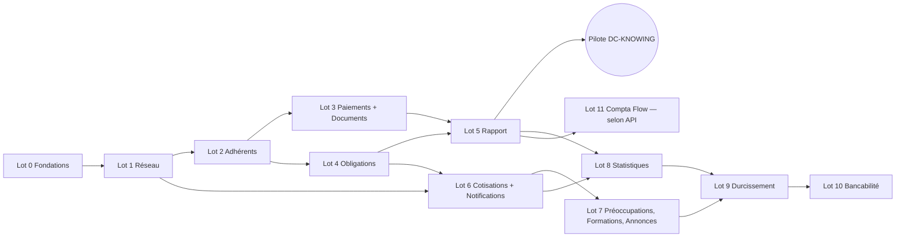

# 06 — Plan d'implémentation · CGA Connect

> Version 1.1 · 15/10/2026 (intégration du compte rendu du 14/10/2026 : étapes 0.12, 1.11–1.12, 2.12–2.16, 3.13–3.15, 4.10–4.11, 5.11–5.13, 6.9 et Lot 11 ajoutés ; charges et calendrier mis à jour) · Références : 01-PRD, 02-TRD, 03-APPFLOW, 04-UX-UI, 05-BACKEND-SCHEMA.
> Équipe : **BE** (développeur backend Laravel), **FE** (développeur frontend React), **QA** (recette et validation).
> Règle d'or pour l'agent : **construire dans l'ordre ci-dessous, une étape à la fois**. Une étape est terminée quand ses critères de fin sont tous vrais. Ne jamais commencer une étape dont les dépendances ne sont pas terminées.

---

## ⛔ 0bis. CONSIGNE FERME — Tests de non-régression et de couverture (non négociable)

**Après chaque fonctionnalité (chaque étape numérotée de ce plan), les tests de non-régression et de couverture doivent être écrits ET exécutés avec succès. Il est interdit de passer à une autre fonctionnalité tant que ces tests ne sont pas validés.**

Pour chaque fonctionnalité, dans cet ordre :

1. **Écrire les tests de la fonctionnalité** :
   - tests unitaires des règles (`RG-xxx` dans le nom du test) ;
   - tests fonctionnels de l'API (succès, validations 422, droits 403 / 404 pour **chaque rôle** de la matrice, conflits 409) ;
   - tests de composants frontend (affichage, formulaire, erreurs, états vide / chargement).
2. **Exécuter la suite complète de non-régression** : **tous** les tests existants du projet, pas seulement les nouveaux — `composer test` (backend), `npm run test:ci` (frontend), ainsi que le test de cloisonnement. Un seul test en échec = fonctionnalité **non terminée**.
3. **Mesurer la couverture** et respecter les seuils (02-TRD §13) :
   - **≥ 85 %** des lignes sur les fichiers créés ou modifiés par la fonctionnalité ;
   - global backend **≥ 80 %**, Actions et Policies **≥ 90 %**, frontend **≥ 70 %** ;
   - **aucune règle `RG-` de la fonctionnalité sans test**.
4. **Corriger jusqu'à ce que tout soit vert.** Il est interdit :
   - de désactiver, supprimer, marquer `skip` ou affaiblir un test existant pour faire passer la suite ;
   - de baisser un seuil de couverture.

   Un test existant qui doit changer parce qu'une règle a changé n'est modifié qu'avec la référence de la décision correspondante (PRD ou registre des décisions).
5. **Consigner le résultat** dans la demande de fusion :
   - nombre de tests et résultat ;
   - couverture globale et des fichiers touchés ;
   - liste des règles `RG-` couvertes.

   La CI refuse la fusion si les tests échouent ou si un seuil n'est pas atteint.
6. **À la fin de chaque lot**, en plus : rejouer les parcours Playwright du 03-APPFLOW §8 déjà disponibles. La recette QA ne commence qu'avec une suite entièrement verte.

> Pour l'agent IA : si un test échoue, la seule action autorisée est de corriger le code ou le test fautif de la fonctionnalité en cours. Ne jamais commencer l'étape suivante, ni « revenir plus tard » sur un test rouge.

---

## 0. Principes de construction

1. **Tranches verticales** : chaque lot livre des fonctionnalités utilisables de bout en bout (migration → Action → API → écran → tests), déployées en recette et validées par QA avant le lot suivant.
2. **Le contrat d'API d'abord** : au début de chaque lot, BE écrit les routes, les FormRequests et les Resources (réponses factices acceptées), publie l'OpenAPI ; FE génère les types et construit les écrans en parallèle.
3. **Chaque règle `RG-xxx` a un test** dont le nom contient l'identifiant.
4. **Définition de terminé (pour chaque étape)** :
   - **consigne §0bis respectée** (tests de la fonctionnalité écrits, suite complète de non-régression verte, seuils de couverture atteints) ;
   - **règles strictes vérifiées** : contrôles OWASP du 02-TRD §6.7 appliqués et testés (validation serveur de toute donnée, `validated()` uniquement, Policy sur chaque route, identifiants recherchés dans le périmètre, champs sensibles calculés par le serveur) ; chaque action de contrôleur passe par `handle()` (try/catch) ; chaque route, Job et commande de la fonctionnalité laisse une trace dans `activity_logs` (et `audit_logs` pour les modifications) ; aucune valeur en dur (nouvelles clés déclarées dans le registre des paramètres) ;
   - migrations et seeders à jour ;
   - Policies et permissions conformes à la matrice PRD §3.3 ;
   - tests Pest et Vitest verts ;
   - test de cloisonnement vert ;
   - écran conforme au 04-UX-UI (états vide, chargement, erreur) ;
   - parcours rejoué en recette par QA ;
   - aucune variable `${…}` restante dans un document.
5. Les valeurs « à confirmer » du PRD §9 sont codées comme **paramètres** (`settings`), jamais en dur.
6. **Données provisoires** (RG-DATA-01 à 05) : chaque jeu de données encore attendu est chargé en version « provisoire » par un seeder et reste **modifiable à l'écran et ré-importable**. Aucun développement ne doit dépendre de la réception des données réelles.
7. **Identifiants d'envoi** (SMS, WhatsApp, e-mail) : saisis dans l'écran « Envois » de l'administrateur (RG-NOT-05), jamais dans le code ni dans `.env`.

---

## 1. Vue d'ensemble des lots

| Lot | Contenu | Livrable utilisable | Indication de charge (jours BE / FE) |
|---|---|---|---|
| 0 | Fondations | Socle technique, connexion, espaces, cloisonnement, modèles validés, rendu des graphiques validé | 13 / 8 |
| 1 | Réseau et CGA | Registre des 111 CGA, fiche CGA, utilisateurs, invitations, droits paramétrables **par profil et par utilisateur**, données de référence provisoires | 15 / 14 |
| 2 | Adhérents et portefeuilles | Inscription, **portefeuilles CGA / Cabinet / Accessoires**, double numérotation, dossier, modification, **radiation en deux temps**, **exclusivité bloquante**, pièces, import | 20 / 19 |
| 3 | Paiements, factures FNE et documents | Droit d'adhésion, honoraires, reçus, **factures certifiées FNE (mode manuel + pilote API)**, contrat, attestation, **blocage manuel**, vérification QR, versions des modèles | 18 / 13 |
| 4 | Obligations et clôture | Catalogue versionné, attribution, échéancier, vues CGA et adhérent, **campagne de clôture** | 16 / 13 |
| 5 | Rapport trimestriel | Fiche permanente, états calculés (portefeuille CGA), **rapport modernisé avec graphiques**, classeur de compatibilité, transmission, échéances J-15 / J-5 / J+5 / J+15, règle « augmentée » paramétrable | 20 / 13 |
| 6 | Cotisations et notifications | Cotisation CNCGA (factures FNE), relances, moteur de notifications, SMS / WhatsApp avec identifiants paramétrables, envois groupés | 12 / 9 |
| 7 | Préoccupations, formations, annonces | Les trois modules | 10 / 11 |
| 8 | Tableaux de bord et statistiques | Agrégats, 3 tableaux de bord, statistiques nationales, carte, exports | 8 / 10 |
| 9 | Durcissement et mise en production | Sécurité, performance, purges, sauvegardes, documentation, pilote | 6 / 4 |
| 10 | Bancabilité (activable) | Module complet, score à 4 critères et pièces paramétrables | 10 / 9 |
| 11 | Connecteur Compta Flow (lecture) | Synchronisation du CA et des paiements d'impôts, Compta Flow fait foi, écran de connexion | 5 / 2 |

**Mise en production pilote (DC-KNOWING) après le Lot 5**, puisque les 3 fonctions indispensables sont alors couvertes (PRD §1.3) — hors cotisation, qui arrive au Lot 6. Les lots 6 à 8 sont livrés en production au fil de l'eau. Le Lot 10 n'est engagé qu'après confirmation du bureau du CNCGA. Le Lot 11 est engagé dès que l'API de Compta Flow est disponible (au plus tôt après le Lot 5) ; en attendant, l'import Excel (F-IMP-03) alimente le rapport.

> **FNE** : la facturation normalisée est déjà obligatoire. Aucune facture ne sort de la plateforme en production sans certification : au pilote, le mode **manuel** (RG-FNE-03) est actif ; le pilote `dgi_api` est branché dès que la DGI fournit l'accès, sans changement fonctionnel.

---

## Lot 0 — Fondations

**Dépendances :** aucune.

| # | Qui | Étape | Critère de fin |
|---|---|---|---|
| 0.1 | BE | Dépôt Git `backend/ frontend/ infra/ docs/` ; copier les 6 documents dans `docs/` ; placer `AGENTS.md` (et sa copie `CLAUDE.md`) à la racine | Dépôt initialisé, README de démarrage, consignes de l'agent en place |
| 0.2 | BE | Environnement **sans Docker** : poste local (Laragon ou équivalent) avec PHP 8.3, PostgreSQL 16 (`pg_trgm`, `unaccent`, `citext`), LibreOffice, Node 20+ ; `infra/` : configurations Nginx, Supervisor (workers par file), cron, `deploy.sh`, `backup.sh` ; guide d'installation du serveur de recette | `php artisan serve` + `npm run dev` fonctionnent ; `GET /api/health` = OK (base, files, disque, LibreOffice) |
| 0.3 | BE | Laravel 13 (API), Sanctum SPA, Pint, Larastan, Pest, Scramble, Sentry ; fuseau Africa/Abidjan, locale `fr` ; files, cache et sessions sur la base (`database`), bascule `redis` testée ; stockage sur le disque `private` (Flysystem) ; Horizon installé seulement si Redis | `/docs/api` affiche l'OpenAPI ; la suite passe avec `QUEUE_CONNECTION=database` et avec `redis` |
| 0.4 | FE | Vite + React 19 + TypeScript, Tailwind v4 avec les jetons du 04-UX-UI §2, shadcn/ui, React Router, React Query, axios, RHF + zod, ESLint, Vitest, Playwright ; script `gen:api` (openapi-typescript) | Page de démonstration avec Button, Card, StatusBadge, DataTable conformes à la maquette |
| 0.5 | BE+FE | Pipeline CI (02-TRD §12.2) avec `composer audit` / `npm audit` et règles d'analyse statique de sécurité **bloquants** (02-TRD §6.7), **seuils de couverture bloquants** (02-TRD §13) et exécution de la suite complète à chaque demande de fusion ; déploiement automatique en recette | Une demande de fusion sous le seuil ou avec un test rouge est refusée |
| 0.6 | BE | Migrations : `users`, `organizations`, `memberships`, `invitations`, `otp_codes`, `files`, `audit_logs` (partitionnée), `settings`, `sequences`, `platform_access_logs` ; seeders `PlatformSeeder`, `SettingsSeeder` | `migrate:fresh --seed` OK |
| 0.7 | BE | Socle : `TenantContext`, middleware `ResolveTenant`, trait `BelongsToOrganization` (scope global + exception sans contexte), `Tenancy::bypass()` journalisé, catalogue `config/permissions.php` (avec `locked`), table `role_permissions` + `PermissionSeeder` (matrice par défaut) + `PermissionResolver` (verrou → ajustement utilisateur → surcharge CGA → réseau, cache selon `CACHE_STORE`), `SettingsService` (clés déclarées et validées), trait `Auditable`, `SequenceService`, `StorageService` (URL signées), `BusinessCalendar` | Tests unitaires de chaque service ; test : une permission verrouillée ne peut jamais être accordée |
| 0.7b | BE | **Règles strictes du socle** : (1) `BaseApiController::handle()` avec `try/catch` et `ApiErrorMapper` (02-TRD §4.4), `BusinessRuleException`, `ExternalServiceException`, en-tête `X-Request-Id` ; (2) journalisation intégrale : table `activity_logs` (partitionnée), middleware `LogActivity` (après réponse, fichier de secours), écouteurs Jobs / Scheduler, expurgation des secrets (02-TRD §6.5) ; (3) registre des paramètres `config/cga.php` + `SettingsService` + interdiction de `env()` hors `config/` (02-TRD §7.6) | Tests génériques : chaque route journalise ; chaque type d'exception donne le bon code ; aucun secret dans les journaux ; toute clé lue est déclarée |
| 0.8 | BE | **Test de cloisonnement générique** (parcourt toutes les routes `/api/v1`) | Test présent et vert, bloquant en CI |
| 0.9 | BE | Authentification : connexion, déconnexion, `/me`, `/me/space`, mot de passe oublié par code (pilote SMS `log`), activation par invitation, limitation des essais | F-AUTH-01 à 05 couverts par des tests |
| 0.10 | FE | `PublicLayout`, écrans `/connexion`, `/mot-de-passe-oublie`, `/activer/:jeton`, `/choisir-espace`, `/profil` ; `AuthContext` ; garde de routes par espace ; coques `CncgaLayout`, `CgaLayout`, `MemberLayout` (menus selon les permissions) ; gestion globale des erreurs (03-APPFLOW §7) | Un utilisateur de démonstration multi-rôles se connecte et change d'espace |
| 0.11 | BE | **Validation des modèles de documents** (02-TRD §8.3) : nettoyer les 4 modèles de la maquette (aucune donnée réelle), les baliser `${…}`, prouver la chaîne DOCX → PDF via LibreOffice installé sur le serveur (`PdfConverter`, profil par worker, délai maximal) et le remplissage du classeur Excel de 14 feuilles (contrôle visuel dans Excel et LibreOffice). Décider PhpSpreadsheet ou plan B XML | Fiche de décision écrite dans `docs/decisions/` ; échantillons générés validés par QA |

| 0.12 | BE | **Validation du rendu des graphiques** du rapport modernisé (02-TRD §8.4) : un DOCX avec 3 graphiques natifs PhpWord (secteurs, barres, courbe) converti en PDF par LibreOffice ; sinon, repli PNG | Décision T-21 consignée dans `docs/decisions/` ; échantillon validé par QA |

**Validation QA du lot :** connexion, mot de passe oublié, activation, changement d'espace, déconnexion automatique.

---

## Lot 1 — Réseau et CGA

**Dépendances :** Lot 0.

| # | Qui | Étape | Critère de fin |
|---|---|---|---|
| 1.1 | BE | Référentiels : migrations et API `regional_directorates`, `tax_offices`, `communes`, `sectors`, `holidays`, `national_references` ; `ReferentialSeeder` | CRUD CNCGA, lecture pour tous |
| 1.2 | BE | Organisations : champs complets, Actions `CreateCga`, `UpdateCgaProfile` (calcul de `profile_completed_at`, RG-ORG-04), `ChangeSubscription`, `SuspendCga` / `ReactivateCga` (Présidente, RG-ORG-08), `WithdrawAgreement` (F-ORG-07, partie suspension) ; table `organization_status_events` | Tests RG-ORG-01 à 09 |
| 1.3 | BE | Import des CGA (F-IMP-01) : `import_batches`, `import_rows`, Job d'import, rapport d'anomalies | 111 lignes importées depuis le modèle |
| 1.4 | BE | Utilisateurs : inviter un agent (CNCGA, CGA), modifier les rôles, désactiver ; envoi d'invitation (e-mail et SMS via pilote `log`) | Tests de la matrice des droits pour ces actions |
| 1.5 | FE | `/cncga/membres` (liste, filtres, import), modale « Nouveau CGA », `/cncga/membres/:id` (onglets Identité, Utilisateurs ; autres onglets vides avec « Bientôt disponible »), suspension, retrait d'agrément, abonnement | Parcours P1 jusqu'à l'invitation du gérant |
| 1.6 | FE | `/cga/parametres` onglets Centre (téléversement logo, signature, cachet) et Utilisateurs ; bannières CGA suspendu, fiche incomplète, agrément en cours | Parcours P1 complet |
| 1.7 | FE | `/cncga/parametres` : Utilisateurs, Secteurs, DR / CDI / communes, Références nationales, Jours fériés, Paramètres réseau | Écrans opérationnels |
| 1.8 | BE | API des droits **par rôle** (02-TRD §6.2 : liste des rôles, droits d'un rôle, écriture, retour au défaut, impact) : catalogue, lecture et écriture réseau (administrateur de la plateforme) et CGA (gérant de chaque centre), retour aux valeurs par défaut, journalisation, invalidation du cache (RG-ROLE-01 à 06) | Tests : surcharge CGA prioritaire ; verrous respectés ; effet immédiat |
| 1.9 | FE | Habilitations par rôle : liste des rôles puis **interface dédiée de chaque rôle** (`RolePermissionsPage`) dans `/plateforme/droits/:role` et `/cga/parametres/droits/:role`, avec modale d'impact ; menus et boutons pilotés par les permissions résolues | Retirer un droit au comptable fait disparaître le bouton correspondant sans reconnexion |
| 1.10 | BE+FE | Données de référence provisoires (RG-DATA-01, 02, 05) : colonnes `data_status`, seeders provisoires (CGA de la maquette, DR / CDI d'exemple), import « mettre à jour / remplacer » avec aperçu, désactivation et fusion, badge « provisoire », onglet « Données de référence » de `/plateforme` | Remplacer la liste provisoire des CGA par un fichier réel ne casse aucune donnée liée |

| 1.11 | BE | Habilitations par utilisateur (RG-ROLE-07) : table `user_permission_overrides`, API lecture (valeur + origine) / écriture / retour au profil, contrôles (verrous, pas sur soi-même, périmètre du gérant), nouveaux profils `cga_tax_advisor`, `cga_billing_officer`, `cga_trainer` dans le catalogue et la matrice par défaut | Tests : ordre de résolution à 4 niveaux ; un retrait individuel l'emporte sur le profil ; un verrou n'est jamais levé |
| 1.12 | FE | `PermissionCloud` dans `/cga/parametres` → Utilisateurs et dans `/plateforme` → Utilisateurs CNCGA ; menus recalculés sur les droits effectifs | Décocher un droit pour un comptable précis masque le bouton pour lui seul |

**Validation QA :** parcours P1 ; un CGA suspendu ne peut plus écrire ; habilitations individuelles.

---

## Lot 2 — Adhérents et portefeuilles

**Dépendances :** Lot 1.

| # | Qui | Étape | Critère de fin |
|---|---|---|---|
| 2.1 | BE | Migrations `members` (avec `portfolio`, `client_number`, `legacy_number`, `referrer_id`, contrat CGA), `member_regime_history`, `member_revenues`, `member_pieces`, `radiations` (deux temps, initiateur), `member_transfers`, `fee_schedules`, `business_referrers`, `portfolio_movements` ; index de recherche trigram | |
| 2.2 | BE | `CreateMemberDraft`, `UpdateMember` (justificatif obligatoire pour raison sociale, NCC, régime ; RG-ADH-06b), `DeleteDraft` (RG-ADH-01) ; normalisation et validation du NCC ; contrôle des doublons (RG-ADH-05, contournement journalisé renvoyant un booléen) | Tests RG-ADH-01, 05, 06b |
| 2.3 | BE | `ValidateMembership` : contrôles RG-ADH-02 (le contrôle « droit d'adhésion payé » est branché au Lot 3 ; d'ici là, un drapeau de configuration le désactive), attribution du numéro RG-ADH-03 (verrou, séquence continue, `abbreviation_locked_at`), création des pièces attendues | Test de concurrence : 20 validations simultanées → 20 numéros distincts consécutifs |
| 2.4 | BE | `ChangeRegime` (historique, RSI / RNI → `rsi_since` + alerte), `RequestRadiation` (initiateur, motifs autorisés, pièces exigées), `ValidateRadiation` (effets 1, 2, 4, 5 du F-ADH-06 ; issue « clore » ou « basculer en Cabinet » ; effet 3 au Lot 3 ; effet 6 au Lot 6), `CancelRadiation` (30 jours, gérant, RG-ADH-11) | Tests RG-ADH-08 à 13 et RG-ADH-17 |
| 2.5 | BE | Pièces : dépôt, statut, calcul de `pieces_status` ; accès en ligne de l'adhérent (invitations `member_owner` / `member_user`) ; réimport depuis un autre CGA (RG-ADH-15) | Tests RG-PJ-01, 02 et RG-ADH-15 |
| 2.6 | BE | Import de portefeuille (F-IMP-02, RG-IMP-01 à 03) : analyse, aperçu, import, rapport ; **double numérotation** (ancien n° conservé + n° CGA Connect chronologique) ; portefeuille et apporteur par ligne | Import de 1 000 lignes < 2 min ; chaque ligne garde son ancien n° |
| 2.7 | FE | `/cga/adherents` (sélecteur de portefeuille, onglets Actifs, Dossiers à compléter, Radiations en cours, Radiés / clos ; recherche par ancien n° ; filtre apporteur ; export différé au Lot 8) | |
| 2.8 | FE | Assistant `/cga/adherents/nouveau` (2 étapes, contrôle du NCC à la volée, proposition de secteur) | Parcours P2 jusqu'à « Adhésion validée » |
| 2.9 | FE | `/cga/adherents/:id` : en-tête, bandeaux, onglets Identité, Pièces, Accès en ligne, Historique ; modales Modifier (avec justificatif), Changer de régime, Radier, Annuler la radiation, Supprimer le brouillon | Parcours P5 |
| 2.10 | FE | `/cga/imports/adherents` | Import validé par QA avec un vrai fichier DC-KNOWING anonymisé |
| 2.11 | FE | Espace adhérent : coque mobile, `/adherent/accueil` (version minimale : identité du CGA, message d'accueil), `/profil` | L'adhérent invité se connecte sur téléphone |
| 2.12 | BE | Portefeuilles (RG-PTF-01 à 08) : deux portefeuilles natifs, contraintes « contrat ↔ portefeuille CGA » et « apporteur = portefeuille CGA », pièce `signed_cga_contract`, numérotation client `CAB-ABR-NNNNN`, scope `regulatory()`, permissions `members.cabinet.view` et `members.referrers.view`, masquage de l'apporteur dans les `JsonResource` | Test bloquant : un dossier Cabinet n'apparaît dans aucune sortie réglementaire ; aucun dossier CGA sans contrat ; aucun apporteur sur un dossier Cabinet ; apporteur absent sans le droit |
| 2.13 | BE | Exclusivité bloquante (RG-ADH-05, T-22) : `AssertMembershipExclusivity` avec verrou consultatif, appelée à la validation et à la bascule ; réponse 409 sans nom de CGA | Test de concurrence : deux CGA valident le même NCC en même temps → un seul succès |
| 2.14 | BE | Bascules (RG-PTF-03 à 05) : `MoveToCgaPortfolio` (régime TEE / RME, contrat signé, exclusivité ; droit d'adhésion branché au Lot 3) ; bascule CGA → Cabinet par `ValidateRadiation` (issue `moved_to_cabinet`, fin du rattachement à l'apporteur) ; `portfolio_movements` ; CRUD des apporteurs ; test d'architecture « radiation toujours manuelle » (RG-ADH-18) | Tests RG-PTF-03 à 08, RG-ADH-18 |
| 2.15 | FE | Assistant avec choix du portefeuille et blocage d'exclusivité ; dossier : `PortfolioBadge`, modales « Demander la radiation » (initiateur → motifs) et « Valider la radiation » (issue), « Basculer vers le portefeuille CGA », « Basculer vers le portefeuille Cabinet » ; champ apporteur limité au portefeuille CGA | Parcours P5 et P12 (sans le paiement) |
| 2.16 | FE | `/cga/parametres` : onglet Apporteurs d'affaires | |

**Validation QA :** inscription dans chaque portefeuille, brouillon, validation, doublon NCC (même CGA) et blocage d'exclusivité (autre CGA), changement de régime vers RSI / RNI, radiation demandée puis validée (clôture et bascule Cabinet), annulation, import avec double numérotation, apporteurs masqués pour un profil sans droit.

---

## Lot 3 — Paiements, factures FNE et documents

**Dépendances :** Lot 2.

| # | Qui | Étape | Critère de fin |
|---|---|---|---|
| 3.1 | BE | Migrations `member_charges`, `member_payments`, `member_payment_allocations`, `document_templates`, `generated_documents`, `document_verifications` ; `TemplateSeeder` | |
| 3.2 | BE | Barème (F-PAY-01) ; création de la charge « droit d'adhésion » à la création du dossier ; `RecordPayment` (CGA), `DeclarePayment` (adhérent, preuve obligatoire), `ConfirmPayment` / `RejectPayment` ; ventilation sur les charges ; statuts | Tests RG-PAY-01, 02 |
| 3.3 | BE | Activer le contrôle « droit d'adhésion payé » dans `ValidateMembership` | Test RG-ADH-02 complet |
| 3.4 | BE | Chaîne documentaire (02-TRD §8.2) : Job `GenerateDocument`, numérotations (formats variabilisés), jeton de vérification, QR, conversion LibreOffice, SHA-256, stockage sur disque via `StorageService`, téléchargement par lien temporaire signé ; événement `DocumentReady` | Document < 10 s en local |
| 3.5 | BE | Documents : contrat, attestation (RG-DOC-06, 07 : année, validité, blocages), reçu, facture, courrier de radiation (effet 3 de F-ADH-06), régénération (RG-ADH-07), annulation (F-DOC-03, RG-DOC-08), dépôt CGA (F-DOC-05) ; visibilité PDF seulement pour l'adhérent (RG-DOC-04) | Tests de chaque type ; aucune variable `${` restante |
| 3.6 | BE | API publique de vérification (F-DOC-04, limitation 30 / min, journalisation) | Test RG-DOC-09 |
| 3.7 | BE | Échéances d'honoraires (`fees:generate`), passage en impayé (`statuses:refresh`, RG-PAY-03, 04), **alerte** à 3 mois (RG-PAY-05, sans blocage automatique) ; blocage / déblocage **manuel** de l'attestation (`attestation_blocks`, RG-DOC-10) ; campagne annuelle d'attestations (exclut radiés, radiations en cours, dossiers Cabinet, attestations bloquées) | Tests RG-PAY-03 à 05, RG-DOC-07, RG-DOC-10 ; aucun blocage sans action du gérant |
| 3.8 | FE | Onglets **Honoraires et paiements** et **Documents** du dossier ; modale de paiement à la validation (03-APPFLOW §4.3) ; bandeau post-validation (produire, inviter) | Parcours P2 complet |
| 3.9 | FE | `/cga/parametres` : Barème, Règles, Campagne d'attestations | |
| 3.10 | FE | Adhérent : `/adherent/documents`, `/adherent/honoraires` (déclaration de paiement) | Parcours P4 (sauf rappels, Lot 6) |
| 3.11 | FE | Page publique `/verifier/:jeton` | QR scanné sur téléphone → page correcte |
| 3.12 | BE+FE | Versionnage des modèles (F-ADM-02, RG-DATA-03) : dépôt d'une nouvelle version, contrôle des variables, prévisualisation, activation ; un document émis garde sa version | Remplacer le modèle provisoire du contrat par le modèle réel sans toucher aux contrats déjà émis |
| 3.13 | BE | Factures FNE (F-PAY-05, F-PAY-06, RG-FNE-01 à 05) : `invoices`, `fne_certifications`, `invoicing_providers` ; interface `FneCertifier` avec pilotes `manual` et `dgi_api` (contre le bouchon `FakeFneCertifier`) ; Job `CertifyInvoice` + `fne:retry` ; PDF produit après certification ; avoirs | Tests : facture non téléchargeable avant certification ; certifiée immuable ; rejet, indisponibilité et reprise ; mode manuel exige numéro et PDF |
| 3.14 | FE | `/cga/factures`, `FneStatus`, modale « Saisir la certification », onglet « Facturation FNE » de `/cga/parametres`, factures dans l'espace adhérent | Parcours P11 |
| 3.15 | BE | Brancher le contrôle « droit d'adhésion payé » dans `MoveToCgaPortfolio` | Parcours P12 complet |

**Validation QA :** parcours P2, P11, P12 de bout en bout ; contrôle visuel des PDF contre les modèles normés (QA + DC-KNOWING), y compris les mentions FNE d'une facture certifiée.

---

## Lot 4 — Obligations et campagne de clôture

**Dépendances :** Lot 2 (le Lot 3 peut avancer en parallèle).

| # | Qui | Étape | Critère de fin |
|---|---|---|---|
| 4.1 | BE | Migrations `obligation_types`, `member_obligations`, `obligation_instances`, `obligation_payments`, `center_obligations` ; `ObligationCatalogSeeder` à partir du référentiel DC-KNOWING (JSON) | 42 obligations chargées, version `2026.1` |
| 4.2 | BE | Moteur d'applicabilité (régime, effectif, secteur) → propositions (RG-OBL-02, 03), confirmation par le CGA ; obligations locales (RG-OBL-01) | Tests unitaires du moteur |
| 4.3 | BE | Générateur d'échéances (`obligations:generate`, horizon paramétrable, règles d'échéance `due_rule`, report jours ouvrés RG-OBL-06, idempotent) ; création du paiement à « faite » (RG-OBL-05) | Tests RG-OBL-04 à 06 ; relancer la tâche 2 fois ne crée aucun doublon |
| 4.4 | BE | Saisie CGA (montant dû, abattement TEE, paiements, confirmation) ; déclaration adhérent (RG-OBL-09) ; statuts dérivés (RG-OBL-07) ; récapitulatifs (RG-OBL-08) ; planning agrégé du portefeuille (F-OBL-06) ; obligations du CGA (F-OBL-07) | Tests RG-OBL-07 à 09 |
| 4.5 | FE | Étape 2 de l'assistant : bloc « Obligations proposées » | |
| 4.6 | FE | Onglet **Obligations** du dossier (4 blocs `ObligationBlock`, actions par ligne, gestion des obligations) | |
| 4.7 | FE | `/cga/echeances` (planning, panneau des adhérents, onglet Mobilisation des recettes) ; `/cga/gestion-interne` onglet Obligations du centre | |
| 4.8 | FE | `/adherent/obligations` (vue mobile, « Signaler comme fait / payé ») ; accueil adhérent complet (F-DSH-03, sans période) | Parcours P3 |
| 4.9 | BE+FE | Versionnage du catalogue des obligations (RG-DATA-04) : import d'une nouvelle version, aperçu des impacts sur les adhérents, application, échéances passées inchangées | Passage du catalogue provisoire au catalogue validé par le CNCGA testé sur 50 adhérents |

| 4.10 | BE | Campagne de clôture (F-OBL-08, RG-OBL-10 à 12) : `closing_campaigns`, `closing_campaign_items`, `closing:open-campaign`, calendrier paramétrable (réseau / CGA, dépôt légal au 30 mai fixé par le CNCGA), avancement par étape, compteurs SMT / bilans du portefeuille CGA, rappels `reminders:closing` (envoi branché au Lot 6) | Tests RG-OBL-10 à 12 ; ouverture idempotente |
| 4.11 | FE | `/cga/cloture` (`StepTimeline`, tableau, actions groupées), onglet Clôture du dossier, `/adherent/cloture` | Une campagne complète simulée sur 20 dossiers |

**Validation QA :** parcours P3 ; échéances correctes sur 3 mois pour un RME avec 5 salariés et pour un TEE sans salarié ; campagne de clôture de bout en bout.

---

## Lot 5 — Rapport trimestriel

**Dépendances :** Lots 3 et 4.

| # | Qui | Étape | Critère de fin |
|---|---|---|---|
| 5.1 | BE | Migrations `cga_people`, `cga_resources`, `quarterly_reports`, `quarterly_report_versions` ; API fiche permanente (F-RPT-01) | |
| 5.2 | BE | Calcul des états (PRD M09) **regroupés par CDI** : Suivi TEE, Suivi RME (par nature d'impôt), Nouveaux TEE / RME, Surclassements, Résiliations, TEE / RME augmentées (règle paramétrable, hypothèse N > N-1), Résumé | Tests sur un jeu de données de référence dont les totaux sont calculés à la main |
| 5.3 | BE | Complétude par section (RG-RPT-02) ; contenu saisi (jsonb) ; enregistrement automatique | |
| 5.4 | BE | Génération : `QuarterlyReportCalculator` (objet de données unique) → classeur de compatibilité 14 feuilles (méthode décidée en 0.11, si `report.legacy_workbook_enabled`) ; versions et instantané (RG-RPT-05) | Classeur ouvert sans erreur dans Excel ; comparaison visuelle validée par DC-KNOWING |
| 5.5 | BE | Transmission (bordereau), accusé, correction ; `summary` exposé au CNCGA (RG-RPT-04) ; date limite J, relances J-15 / J-5 / J+5 et échéance réglementaire J+15 paramétrables (RG-RPT-06, 07 ; envois branchés au Lot 6) ; F-ORG-07 (état des résiliations pour une perte d'agrément) | Test : aucune route CNCGA ne renvoie un nom d'adhérent |
| 5.6 | BE | Import d'historique CA et paiements d'impôts (F-IMP-03) | |
| 5.6b | BE+FE | Règle « cotisation augmentée » paramétrable (RG-RPT-08) : clé `report.increase_rule`, écran « Règles du rapport », paramètre enregistré dans l'instantané de chaque version | Changer la règle modifie le contenu des feuilles « augmentée » à la génération suivante, sans toucher aux versions déjà produites |
| 5.7 | FE | `/cga/gestion-interne` onglet Fiche permanente | |
| 5.8 | FE | `/cga/rapports` et `/cga/rapports/:id` (sommaire, sections, anomalies, prévisualisation, génération, transmission, accusé, versions) | Parcours P6 |
| 5.9 | FE | `/cncga/rapports` (grille CGA × trimestre, panneau du tableau de synthèse) ; onglet Rapports de la fiche CGA | |
| 5.10 | BE | Classeur officiel remplaçable : le classeur provisoire (modèle de la maquette nettoyé) est une version de `document_templates` ; le dépôt de la version officielle du SP-CGA passe par 3.12 avec un contrôle de structure (14 feuilles, cellules attendues) | Dépôt d'une nouvelle version du classeur sans développement |

| 5.11 | BE | Rapport modernisé (RG-RPT-09 à 12, 02-TRD §8.4) : modèle `rapport_modernise`, graphiques (méthode 0.12), synthèse pré-rédigée depuis les fichiers de traduction, analyse qualitative, source de chaque donnée ; reprise des compteurs de la campagne de clôture | Test : agrégats identiques entre rapport modernisé et classeur ; aucun dossier Cabinet |
| 5.12 | FE | Section « Analyse qualitative », graphiques des états (`Charts`), `DeadlineBanner`, `SourceTag`, aperçu du rapport modernisé | Parcours P6 |
| 5.13 | BE+FE | Paramètres réseau du rapport (`/plateforme` et `/cncga/parametres`) : décalages de relance, échéance réglementaire, export de compatibilité | |

**Validation QA :** parcours P6 avec les données réelles anonymisées de DC-KNOWING ; le rapport modernisé et le classeur de compatibilité sont acceptés par DC-KNOWING.

### ▶ Mise en production pilote (DC-KNOWING)
Préalables :
- étapes 9.1 à 9.4 du Lot 9 faites en version minimale (sauvegardes, supervision, en-têtes de sécurité, revue des droits) ;
- import du portefeuille réel (double numérotation) ;
- facturation FNE en mode manuel paramétrée ;
- formation des agents de DC-KNOWING ;
- 3 mois d'essai (abonnement `trial`).

---

## Lot 6 — Cotisations CNCGA et notifications

**Dépendances :** Lots 1 et 4.

| # | Qui | Étape | Critère de fin |
|---|---|---|---|
| 6.1 | BE | Moteur de notifications : canaux `database`, `mail`, `sms`, `whatsapp` ; `message_logs` ; `notification_preferences` ; `config/notifications.php` (essentielle ou non) ; plage 7 h–20 h (RG-NOT-02) ; repli SMS sans e-mail (RG-NOT-03) ; quotas SMS (`sms_quotas`) | Tests RG-NOT-01 à 04 |
| 6.2 | BE+FE | Pilotes SMS (`orange_ci`, `http_generic`), WhatsApp Cloud API et SMTP lisant leur configuration dans `messaging_providers` ; écran « Envois » de `/plateforme` (identifiants chiffrés, interrupteur, **message de test**) ; repli plateforme + e-mail quand un canal est inactif (RG-NOT-05) | Identifiants saisis dans l'écran, test réussi en recette vers les numéros de l'équipe, aucun identifiant dans `.env` |
| 6.3 | BE | Toutes les notifications de la table PRD M13 et les tâches `reminders:*` (02-TRD §11), dont rapport J-15 / J-5 / J+5 / J+15, clôture, radiation demandée / validée, FNE ; effet 6 de la radiation | Chaque ligne de la table a un test |
| 6.4 | BE | Cotisations : `network_dues`, `network_due_payments`, `dues:open-year` (montant, mode, date butoir, prorata — paramètres), déclaration CGA, saisie et confirmation CNCGA, reçus, relances J+30 / 60 / 90, alerte à la Présidente (RG-COT-01 à 06) | Tests RG-COT-01 à 06 |
| 6.5 | BE | Envois groupés (`message_campaigns`) : filtres de destinataires, validation au-delà de 50 (RG-COM-01), décompte du quota (RG-COM-02), historique | |
| 6.6 | FE | Cloche de notifications et panneau ; préférences dans `/profil` ; consentements à l'activation | |
| 6.7 | FE | `/cncga/cotisations` ; onglet Cotisations de la fiche CGA ; `/cga/cotisation` | Parcours P7 |
| 6.8 | FE | `/cga/communications` (envois groupés, assistant de 4 étapes, validation, historique) ; bouton « Envoyer un rappel » depuis `/cga/echeances` | Parcours P4 complet |
| 6.9 | BE+FE | Factures de cotisation CNCGA certifiées FNE (réutilise 3.13 avec `billed_organization_id`) ; bouton « Facturer » de `/cncga/cotisations` ; aucune suspension automatique (RG-COT-06) | Facture de cotisation certifiée téléchargeable par le CGA |

---

## Lot 7 — Préoccupations, formations, annonces

**Dépendances :** Lot 6.

| # | Qui | Étape | Critère de fin |
|---|---|---|---|
| 7.1 | BE | Préoccupations : `concerns`, `concern_messages`, pièces jointes, notes internes, statuts et réouverture, transfert au CNCGA avec copie (F-PRE-03), délais et alerte à 15 jours, indicateurs agrégés pour le CNCGA (RG-PRE-03) ; demandes de document (F-DOC-06) | Tests RG-PRE-01 à 03 |
| 7.2 | BE | Formations : `trainings`, `training_audiences`, `training_registrations` ; ciblage (RG-FOR-01, 02), capacité et liste d'attente avec promotion (RG-FOR-03), désinscription J-2, validation, statut de paiement et reçu (RG-FOR-06), présence, attestations, évaluations | Tests RG-FOR-01 à 06 |
| 7.3 | BE | Annonces : CNCGA (3 ciblages) et CGA ; lectures | |
| 7.4 | FE | Préoccupations : `/cncga/preoccupations`, `/cga/preoccupations`, `/adherent/messages` (fils, `ConversationThread`) | Parcours P8 |
| 7.5 | FE | Formations : `/cncga/formations`, `/cga/formations` (dont l'inscription des agents et adhérents aux formations du réseau), `/adherent/formations` | Parcours P9 |
| 7.6 | FE | Annonces : `/cncga/communications`, onglet Annonces du CGA, « Message de mon CGA » chez l'adhérent | |

---

## Lot 8 — Tableaux de bord, statistiques, exports

**Dépendances :** Lots 5 et 6 (et 7 pour les indicateurs de préoccupations).

| # | Qui | Étape | Critère de fin |
|---|---|---|---|
| 8.1 | BE | Agrégats `stat_org_daily`, `stat_network_monthly` (portefeuille CGA uniquement) ; `stats:refresh` + recalcul ciblé dédoublonné ; couverture ; seuil de 5 CGA (RG-STA-04) | Tests RG-STA-01 à 05 |
| 8.2 | BE | API des 3 tableaux de bord avec période en dimension et comparaison N-1 (F-DSH-04) ; statistiques nationales (formules F-STA-01, RG-STA-03) ; données de carte par DR et commune | Réponse < 500 ms |
| 8.3 | BE | Exports Excel en tâche de fond (F-EXP-01, RG-SEC-06) ; plaquette PDF annuelle (F-STA-03) | |
| 8.4 | FE | Tableaux de bord `/cncga`, `/cga`, `/adherent` complets (`PeriodSelector`, `KpiCard`, graphiques, alertes cliquables) | |
| 8.5 | FE | `/cncga/statistiques` (indicateurs, graphiques, `EconomicMap` avec d3-geo) ; `/cga/statistiques` | |
| 8.6 | FE | Boutons Exporter sur toutes les listes concernées | |

---

## Lot 9 — Durcissement et généralisation

**Dépendances :** Lots 7 et 8.

| # | Qui | Étape | Critère de fin |
|---|---|---|---|
| 9.1 | BE | Sauvegardes chiffrées et test de restauration documenté | Restauration réussie en recette |
| 9.2 | BE | Supervision : Sentry, `/api/health`, alertes de files, journaux JSON | |
| 9.3 | BE+FE | Sécurité : revue complète des 10 risques OWASP (02-TRD §6.7) catégorie par catégorie, en-têtes (CSP, HSTS), limitations de débit, matrice des droits ligne par ligne, chiffrement des champs sensibles, test de cloisonnement étendu, scan OWASP ZAP complet et test d'intrusion léger | Rapport de revue OWASP sans anomalie haute ni moyenne non traitée |
| 9.4 | BE | Purges et anonymisation (`retention:purge`, `users:inactivity`, `members:radiation-expiry`), résiliation d'un CGA avec export complet (RG-ORG-07) | Tests PRD §7 |
| 9.5 | BE | Accès support `platform_admin` journalisé et export du journal d'accès pour un CGA (RG-SEC-04) ; espace `/plateforme` | |
| 9.6 | BE+FE | Performance : vérification des cibles 02-TRD §12.4 avec un jeu de 50 000 adhérents | Cibles atteintes |
| 9.7 | FE | Accessibilité (contrôle WCAG AA des écrans principaux), finitions responsive | |
| 9.8 | QA | Guides utilisateurs par espace (PDF courts), jeu de démonstration de recette | |

---

## Lot 10 — Bancabilité (après confirmation du bureau du CNCGA)

| # | Qui | Étape | Critère de fin |
|---|---|---|---|
| 10.1 | BE | Migrations `banking_consents`, `banking_pieces`, `banking_scores`, `banks`, `financing_requests` ; activation par CGA (`banking_enabled`) | Module invisible si désactivé |
| 10.2 | BE | Consentement (RG-BNK-01), pièces paramétrables (`banking_piece_types`) et expirations (RG-BNK-02), score à 4 critères (solvabilité / poids 60, conformité 15, assiduité / réactivité 15, avis bancaire 10) et sous-critères calculés depuis les paramètres et historisés avec eux (F-BNK-03, RG-BNK-03 à 05), recalcul global, banques, demandes, dossier PDF | Tests RG-BNK-00 à 05 ; poids dont la somme ≠ 100 refusés |
| 10.3 | FE | `/cga/bancabilite`, onglet Bancabilité du dossier (avec saisie de l'avis bancaire), `/adherent/bancabilite`, onglet « Bancabilité » de `/cncga/parametres` (critères, sous-critères, poids) | |

---

## Lot 11 — Connecteur Compta Flow (dès que l'API est disponible)

**Dépendances :** Lot 5 ; documentation et environnement de test de l'API Compta Flow (DC-KNOWING).

| # | Qui | Étape | Critère de fin |
|---|---|---|---|
| 11.1 | BE | `flow_connections`, `sync_runs`, `external_references` ; interface `FlowConnector`, pilote `compta_flow` et bouchon `FakeComptaFlow` ; liste blanche des hôtes | Tests de connexion, de délai et de refus d'un hôte non autorisé |
| 11.2 | BE | Job `SyncComptaFlow` + tâche `flow:sync` : rapprochement par NCC, écriture dans `member_revenues` / `member_monthly_revenues` / `obligation_payments` avec `source = compta_flow`, priorité Flow et écarts tracés (RG-DATA-06), valeurs verrouillées, rapport de synchronisation, notification en cas d'échec | Tests RG-DATA-06, 07 ; deux synchronisations successives ne créent aucun doublon |
| 11.3 | FE | Onglet « Compta Flow » de `/cga/parametres` (connexion, test, synchronisation, historique, NCC non rapprochés) ; `SourceTag` dans le dossier et le rapport | Rapport généré avec des données Compta Flow d'un CGA de test |

---

## 2. Organisation du travail au quotidien

- **Branches** : `main` protégée ; une branche par étape (`lot2/2.3-validate-membership`) ; fusion après revue croisée BE ↔ FE.
- **Démonstration** en fin de lot à DC-KNOWING et au référent du CNCGA ; les retours sont classés « correction » (dans le lot) ou « évolution » (backlog).
- **Recette** : QA rejoue les critères de fin et les parcours du lot ; tout bloquant est corrigé avant le lot suivant.
- **Données attendues** (PRD §9) : le développement avance avec des données provisoires (§0, point 6). Les données réelles sont saisies ou importées dans l'application dès réception, idéalement avant :
  - Lot 1 : liste des 111 CGA, DR / CDI ;
  - Lot 3 : modèles anonymisés ;
  - Lot 4 : référentiel de 42 obligations ;
  - Lot 3 : accès à l'API FNE de la DGI (sinon mode manuel) ;
  - Lot 5 : version officielle du classeur (export de compatibilité) et avis du SP-CGA sur le rapport modernisé ;
  - Lot 6 : comptes SMS et WhatsApp (identifiants saisis par l'administrateur dans l'écran « Envois ») ;
  - Lot 8 : nomenclature des codes d'activité, références nationales ;
  - Lot 10 : définition des critères bancaires avec les banques partenaires ;
  - Lot 11 : API de Compta Flow.

## 3. Risques de planning

| Risque | Effet | Parade |
|---|---|---|
| Fidélité du classeur Excel officiel | Blocage du Lot 5 | Prouvé dès l'étape 0.11, plan B XML ; le classeur n'est plus qu'un export de compatibilité |
| Rendu des graphiques du rapport modernisé | Rapport moins lisible | Prouvé dès l'étape 0.12, repli PNG |
| Accès à l'API FNE de la DGI tardif | Certification manuelle prolongée | Mode manuel conforme dès le pilote ; pilote API prêt contre un bouchon |
| API Compta Flow non disponible | Pas d'alimentation automatique | Import Excel (F-IMP-03) ; Lot 11 isolé et déplaçable |
| Référentiel d'obligations incomplet ou non validé | Échéances fausses | Chargement versionné, validation CNCGA avant le Lot 4, obligations locales possibles |
| Comptes SMS / WhatsApp tardifs | Rappels limités | Plateforme + e-mail d'abord, SMS activé dès que prêt |
| Équipe de 2 développeurs | Retards en cascade | Tranches verticales, aucun travail spéculatif, évolutions du PRD §2.3 hors plan |
| Données de reprise de mauvaise qualité | Imports rejetés | Import en brouillon avec rapport, assistance de l'équipe au pilote |

## 4. Calendrier indicatif avec un agent de développement IA

Charge sans agent (somme du tableau §1, consigne de tests §0bis comprise) : **153 jours backend, 125 jours frontend** (126 / 107 avant le compte rendu du 14/10/2026), soit environ 7,5 mois calendaires avec BE et FE en parallèle.

Avec un agent de développement IA utilisé par chacun des deux développeurs, on retient un gain d'environ 45 % sur l'écriture du code. Ce gain est fort sur les écrans, les formulaires, les API, les migrations et les tests ; il est plus faible sur les documents officiels et le rapport. La recette, les démonstrations, les données réelles et les dépendances externes ne sont pas accélérées. Une marge de 20 % est incluse.

| Semaines | Lots | Jalon |
|---|---|---|
| S1–S2 | Lot 0 | Socle, connexion, cloisonnement, modèles de documents et graphiques validés |
| S3–S4 | Lot 1 | Registre des CGA, droits par profil et par utilisateur, données de référence provisoires |
| S5–S7 | Lot 2 | Adhérents, portefeuilles, radiation en deux temps, import avec double numérotation |
| S8–S10 | Lots 3 et 4 | Paiements, factures FNE, documents avec QR, obligations, campagne de clôture |
| S11–S12 | Lot 5 | Rapport trimestriel modernisé → **mise en production pilote DC-KNOWING (fin S12, ≈ 3 mois)** |
| S13–S14 | Lot 6 | Cotisations, notifications, SMS / WhatsApp |
| S15 | Lot 7 | Préoccupations, formations, annonces |
| S16 | Lot 8 | Tableaux de bord, statistiques, carte |
| S17 | Lot 9 | Durcissement → **ouverture aux autres CGA (fin S17, ≈ 4,25 mois)** |
| S18 | Lot 10 | Bancabilité (si confirmée) |
| S19 | Lot 11 | Connecteur Compta Flow (dès que l'API est disponible ; peut être avancé en parallèle après S12) |

**Fourchette réaliste : 4,5 à 5 mois** jusqu'à la version complète, bancabilité et Compta Flow compris. La consigne de tests §0bis allonge légèrement chaque étape mais évite les régressions coûteuses en fin de projet.

Conditions pour tenir ce calendrier :
1. Les documents attendus (§2) sont fournis avant le lot qui en dépend.
2. La recette de chaque lot est faite en 2 à 3 jours, avec des retours regroupés.
3. Les développeurs maîtrisent Laravel et React. L'agent travaille étape par étape (une étape du plan = une session), avec relecture humaine de chaque fusion.
4. Pas de nouvelle fonctionnalité en cours de route : les demandes nouvelles vont dans le backlog des évolutions.
